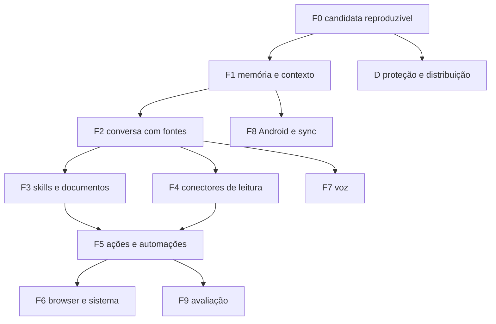

# Roadmap integrado — JARVIS Victor OS

**Data:** 17 de outubro de 2026.
**Estado:** proposta de sequência. Este arquivo não aceita gate, não promove branch e não autoriza merge, push, ativação de banco diário, leitura de dados pessoais ou institucionais, OAuth, gasto, instalação de ferramenta remota, deploy ou efeito externo.

Fontes reconciliadas:

- `AGENTS.md`, seção 6, inclusive o planejamento de 16/10/2026 deste checkout.
- `JARVIS_Blueprint_v0.1.md`, gates 0 a 5.
- Aceites e código já presentes na `main` local `21f1537e14706a42e8272f92cb4f4b6dab746640` (8/10/2026).
- Candidata `codex/jarvis-integration-candidate`, `636d5bdbddcbe0b609871f7a88c64543cde7dfa0` (13/10/2026), 11 commits à frente dessa `main` e ainda não integrada.
- `Jarvis_Analise_Comparativa_2026-10-17.md` e `Jarvis_Roadmap_Reconstruido_2026-10-17.md`.
- `docs/ANALISE_PLAYLIST_JARVIS_2026-09.md`, já absorvida em parte pelo plano de 16/10.

O checkout aberto em 17/10/2026 é `feat/gate2.0-e-integracao-web-api` em `e648e92` (24/09/2026), ancestral da `main` e 109 commits atrás dela. O texto de gate deste checkout descreve essa branch. A `main` e a candidata estão adiante.

## 1. O que já estava no repositório

| Origem | Conteúdo que permanece |
|---|---|
| Blueprint | Gate 0 auditoria; Gate 1 protótipo; Gate 2 leitura com proveniência; Gate 3 proposta supervisionada; Gate 4 Drive/GitHub e fronteira de domínios; Gate 5 voz com fallback de texto. Wake word, Android Auto, automação financeira, dado clínico e exposição pública ficam de fora do primeiro ciclo. |
| `AGENTS.md` deste checkout | Gates 1, 2.0-B, C.1, C.2 e D aceitos no escopo de cada tag. Gate 2.0-E implementado nesta branch e, neste arquivo, ainda sem auditoria. Escrita externa só depois de idempotência, concorrência, revogação e consentimento. |
| Plano de 16/10 | Ordem então aprovada: missões e skills sintéticas; voz com início explícito, transcrição visível, interrupção e fallback, sem wake word e sem escuta contínua; observadores somente leitura só depois de scheduler real e fonte autorizada, com frequência, validade, pausa, horário silencioso e limite de alertas. |
| Playlist de setembro | Skills com permissão declarada, artefato em rascunho com evidência, e observador que avisa só diante de mudança. Mensageria externa, controle geral do computador e câmera permanente continuam fora do horizonte imediato. |

Na `main`, com registro documental e sem tag nova depois de `gate2-d-accepted-v0.1`, também constam: aceite do Gate 2.0-E em 25/09/2026 no SHA `ee5fc29220bbd594f5456ae51ed07f7e2e1fabd5`; G3, G4 e G5 na linha cujo aceite formal de G5 é 01/10/2026, SHA `ab7f856ee834b7f9923d914639e0e345dbf57322`, escopo local, sintético e de um processo; G6.0 em documentos; aceite local de 08/10/2026 para o transporte autenticado e para uma jornada sintética de leitura de missão na janela Tauri. Empacotamento, notarização, OAuth, Calendar real, Gmail, Drive, dado pessoal, acesso remoto e deploy ficaram fora desse aceite.

Os 11 commits da candidata, acima da `main`, acrescentam captura diária local, consentimento nativo de revisão, rascunho sintético e composição de workflows, aprovações e automações. Isso ainda não é a `main`.

O material de 17/10 relata, além desse commit, restore DEC-08-A, 30 arquivos modificados e 10 não rastreados, scheduler persistente, voz Swift e memória em worktrees separadas. Esses relatos não foram reauditados neste checkout. Entram como pendência a inventariar, não como entrega aceita.

## 2. O que os documentos de 17/10 acrescentam

Isto não estava na seção 6 do `AGENTS.md`, no blueprint nem na playlist:

1. Três marcos de prontidão: M1 assistente local útil, M2 copiloto conectado, M3 produto instalável e móvel.
2. Fases F0 a F9 e a trilha D, com os identificadores J00–J92 e D01–D08, dependências e critérios de aceite.
3. Próxima fatia funcional: capturar, buscar por texto, abrir a origem, corrigir e apagar, em banco sintético, antes de modelo e conector real.
4. Memória em quatro categorias separadas: captura explícita, fato ou preferência confirmada, evidência de fonte externa e proposta inferida. A resposta do assistente não vira fato do usuário.
5. Busca inicial em FTS5. Embeddings e fusão de rankings só depois de ganho medido num corpus fixo, com ACL e latência preservadas.
6. Ciclo de vida de fonte: pasta aprovada, ignore, fingerprint, indexação incremental, pausa, limpeza de órfãos e abertura por identificador. Revogação no meio do job impede reentrada no índice.
7. Módulos de responsabilidade, encaixados no código atual: contexto autorizado, gateway de modelo, registro de ferramentas, política determinística, coordenação de execução, artefatos por ID, diário de eventos e registro de skills. Nomes de responsabilidade, não autorização para reestruturar o repositório.
8. Contrato de execução: identidade no backend, orçamento de tempo, chamadas, tokens, bytes, fan-out e custo, detecção de repetição, cancelamento que não apaga efeito já confirmado, e resultado externo incerto com reconciliação.
9. Provider falso antes de provider real. Destino de armazenamento, processamento e envio aparece separado. Fallback remoto silencioso fica proibido.
10. Skills versionadas com origem, hash e licença. Script de skill não executa sozinho. Importação de terceiro fica em quarentena, com diff de permissões. `allowed-tools` de uma skill não é grant do usuário.
11. MCP, se vier, entra por allowlist de ferramenta, schema e versão. Anotação remota não decide se a operação é somente leitura.
12. Aprovação amarrada a objeto, conta, ferramenta, schema, skill, efeito e expiração. Mudança invalida a aprovação anterior.
13. Outbox e idempotência antes de qualquer escrita externa. Timeout depois de um efeito possível produz estado incerto, não retry cego.
14. Proteção do banco aberto, WAL, índices, caches, logs e backups antes de dado pessoal. O backup cifrado do C.2 não cumpre esse requisito.
15. Distribuição: runner que funciona sem a worktree, assinatura, notarização, update verificado e rollback que não corrompe schema.
16. Corpus de 60 cenários sintéticos, com desenvolvimento separado de holdout, e metas de engenharia ainda não medidas.
17. Contratos de verificação G01–G20.
18. Hardware de referência para meta de desempenho: Mac mini Intel de 2018, i5, 32 GB, SSD de 256 GB. MLX não é o backend padrão dessa máquina.
19. Android deixa de ser só scaffold: decisão explícita de onde o processamento mora, APK, pareamento e sync com exclusão durável.
20. Gestos, visão de tela, browser, código isolado, wake word e vários agentes entram só nas fases tardias, cada um com fronteira própria.

Wake word e escuta contínua continuam fora do Gate 5 imediato. No material novo, wake word é J72, prioridade P3, opt-in, e não autentica ação. Observadores do plano de 16/10 continuam em J55: scheduler real, fonte autorizada, horário silencioso, deduplicação e alerta só por mudança relevante. O worker descrito na candidata vive enquanto o runtime vive. Mac desligado não executa automação.

## 3. Marcos

| Marco | Pronto quando | Ainda não demonstra |
|---|---|---|
| **M1 — assistente local útil** | Capturar, buscar, corrigir, apagar e recuperar contexto; conversa com fontes; histórico e tarefas locais confiáveis | Conector real, controle do computador, Android e distribuição pública |
| **M2 — copiloto conectado** | Fontes reais autorizadas, rascunhos, documentos, skills revisadas e execução aprovada com recuperação | Autonomia irrestrita ou execução com o Mac desligado |
| **M3 — produto instalável e móvel** | Instalação, atualização e recuperação; dados protegidos; UX validada; Android e sync decididos e implementados no desenho escolhido | Segurança universal ou competência em qualquer tarefa |

Dado sintético pode avançar com os gates de uso pessoal e de distribuição ainda abertos. Smoke visual pendente impede declarar aquele fluxo validado. Não suspende, por si só, uma fatia sintética independente.

## 4. Mapa dos gates antigos

| Gate já nomeado | Onde fica na sequência nova | Leitura em 17/10 |
|---|---|---|
| 0 e 1 | Fundação | Aceitos |
| 2.0-B, C.1, C.2, D | Fundação e trilha D | Aceitos no escopo da tag. C.2 não é cifra do banco aberto |
| 2.0-E | Fundação | Aceito na `main` para integração local sintética. Neste checkout, o `AGENTS.md` ainda o descreve como pendente de auditoria |
| Blueprint Gate 2 real (Calendar/Gmail somente leitura) | F4, J40–J41 | Não iniciado como conta real |
| Gate 3 / G3–G5 | Fundação de F3 e F5 | Entregue na linha da `main` para missão, execução supervisionada e aprovação sintética. J30, J50 e J51 ampliam esse núcleo |
| Plano de 16/10, skills | F3, J30–J31 | Catálogo sintético existe; registro versionado, quarentena e licença não |
| Blueprint Gate 4 | F4, J42, e J44 | Drive/GitHub reais não iniciados |
| Gate 5 / G6.2 | F7, J70–J71 e J73 | Arquitetura escrita. PTT com smoke acústico não comprovado. J72 fica depois |
| G6.1 | Fundação parcial e D04–D06 | Jornada local de leitura aceita em 08/10. Empacotamento e paridade completa abertos |
| G6.3–G6.5 | F8 e F9 | Esqueleto Android. Identidade, sync e QA integrado abertos |
| Observadores da playlist e de 16/10 | F5, J55 | Dependem de scheduler aceito e fonte autorizada |
| Artefatos com evidência | F3, J32–J34 | Não entregues como produto |

## 5. Regras que passam a valer junto com o `AGENTS.md`

1. Confirmar branch, HEAD, base e status antes de cada fatia. Arquivo sem commit não está no HEAD.
2. Preservar modificação local e arquivo não rastreado. Não usar reset, clean, staging, commit, merge ou push sem pedido explícito.
3. Uma capacidade vertical por vez, com estado inicial, estado final e resultado observável.
4. Modelo, skill, página, e-mail, voz e resposta de ferramenta não concedem permissão. A política no código revalida a chamada.
5. Conteúdo externo, memória recuperada e resultado de ferramenta são dados. Não recebem papel de política.
6. Contrato atual de transporte: protocolo v3 e teto de 2.048 bytes. Conteúdo grande usa artefato com identificador opaco, ACL, hash e leitura fragmentada. Sem URL ou caminho genérico escolhido pelo modelo.
7. Índice, cache e trace novos entram no inventário de retenção, exclusão e proteção.
8. Ausência ou mudança de schema bloqueia a execução até revisão. O servidor externo não é a única autoridade do que sai da máquina.
9. Todo executor recebe identidade, grants e política de egress. Não existe executor criado sem esse contexto.
10. Classificação de dado nasce na origem confiável e acompanha resumo, embedding e artefato. Regex não é a classificação.
11. Aprovar e executar a mesma representação. Não aprovar um prefixo e executar um comando maior.
12. Deadline, número máximo de tentativas e resultado terminal. Retry segue a semântica da ferramenta.
13. Interação humana tem prioridade sobre job de fundo. Resposta de geração antiga não altera a sessão atual.
14. Mostrar, em separado, onde o dado fica, onde é processado e para onde pode ir.
15. Licença e proveniência por componente antes de copiar código de referência. Referência de produto não vira dependência. GPLv3, AGPLv3 e repositório sem licença geral não entram por cópia.
16. Não orientar desativação de proteção do macOS ou de antivírus para contornar assinatura ou aviso.
17. Banco diário, conta real e efeito externo continuam bloqueados até autorização específica.

## 6. Sequência

Desenho e protótipo sintético podem ocorrer antes da fase. Declarar a fase pronta exige o critério da tabela. Proteção e distribuição são transversais.

### F0 — candidata reproduzível

| ID | Prioridade | Entrega | Aceite |
|---|---|---|---|
| J00 | P0 | Inventário da candidata, da `main` e dos antecedentes de memória, conversa e voz | Branch, HEAD, base, status, migrations e hashes registrados, sem trabalho descartado |
| J01 | P0 para restore | Revisão adversarial do DEC-08-A, se ainda não houver resultado | Concorrência, versão antiga, WAL, crash e rollback. Corrigir só defeito reproduzido. Banco preexistente continua inelegível. Sem ativar banco diário |
| J02 | P1 | Manifesto de build e backend | O artefato identifica fonte, frontend e runtime. Diferença local entra no manifesto ou fica de fora de propósito |
| J03 | P1 para aceite visual | Smoke nativo isolado no Mac | Instância temporária, diálogos reais, sem aprovar ação por um atalho de teste e sem mexer no app já aberto |
| J04 | P1 | Harness de tarefas e métricas locais | Corpus, verificador e denominador. Mock separado de provider real. Sem conteúdo sensível em log |

### D — proteção, operação e distribuição

Origem nova: banco aberto em claro, logs que podem copiar pergunta, fronteiras além do SQLite e instalação que hoje depende da worktree.

| ID | Prioridade | Entrega | Aceite |
|---|---|---|---|
| D01 | P0 antes de dado pessoal | Inventário e ADR de proteção em repouso | Tabelas, WAL, índices, anexos, logs, caches, backups, chaves e destinatários nomeados |
| D02 | P0 antes de dado pessoal | Proteção aprovada e desbloqueio | Perda de chave, recuperação, rotação, bloqueio e migration em cópia sintética. Chave ao lado do conteúdo em claro não conta |
| D03 | P1 | Segredo de runtime e de provider fora de WebView, argv e log | Revogação e falha de Keychain testadas |
| D04 | P1 | Runner empacotado | Instalação nova sem árvore de código, `uv` global ou caminho da worktree. Update preserva capacidade instalada |
| D05 | P1 para distribuição | Assinatura, notarização e update íntegro | Update adulterado é recusado. Matriz Intel e Apple Silicon conforme o suporte declarado |
| D06 | P1 | Upgrade, downgrade e recuperação | Banco de versão futura é recusado com clareza. Rollback de app não corrompe schema |
| D07 | P1 | Licenças e advisories da árvore resolvida e do bundle | Obrigações por componente e correção pontual |
| D08 | P1 | Onboarding, diagnóstico, exportação e remoção | Modo offline visível, exportação, exclusão e desinstalação com escolha de preservar ou apagar dados |

A escolha entre SQLCipher, cifra por campo ou outra alternativa compara FTS, WAL, busca, backup, leases, migration e recuperação antes de pedir aprovação. O C.2 cobre backup cifrado de banco sintético isolado. Não substitui D01 nem D02.

### F1 — memória encontrável

| ID | Prioridade | Entrega | Aceite |
|---|---|---|---|
| J10 | P1, primeira subentrega funcional | Busca literal de capturas e abertura da origem | Criar, buscar, abrir origem, corrigir, buscar de novo e apagar no banco aberto. A consulta é texto, não expressão. Acento em PT-BR casa. Apagar tira o item da busca corrente |
| J11 | P1 | Contrato de memória, domínio e proveniência | Quatro categorias separadas. Fonte, timestamp, versão e ACL. Teste negativo entre domínios |
| J12 | P1, contrato separado | Exclusão diante de restore, cache e derivado | O contrato está na candidata, `docs/adr/012-local-purge-export-and-backup-resurrection.md`. Apagar vale para o banco aberto. Backup anterior pode repor o texto. Tombstone e expiração de backup continuam sem decisão |
| J13 | P1 | Ingestão de pasta e arquivo aprovados | Ignore, limite de tamanho, symlink, arquivo alterado e formato malformado. Extração parcial declara o que faltou |
| J14 | P2 | Indexação incremental e job cancelável | Fingerprint, fila limitada, pausa e retomada. Revogação durante o job não reindexa conteúdo novo |
| J15 | P2, condicionado | Busca híbrida | Ganho medido em PT-BR e em código exato, com ACL e latência. Sem ganho, permanece FTS |

A primeira entrega J10 usa captura já existente em banco sintético. Embeddings ficam fora. Há menção, no material de 17/10, a uma migration histórica `0018` que não integrava o ledger da candidata. Qualquer migration nova é aditiva sobre o ledger real, testada em cópia temporária, sem renumerar migration já aplicada. Isso só vale na árvore cujo schema for o inspecionado.

Formatos, nesta ordem: TXT e Markdown; PDF textual, DOCX e CSV; OCR e imagem. Extrator tem teto de tamanho, páginas, tempo, memória e profundidade. Compactado com traversal, conteúdo ativo e download implícito são recusados.

### F2 — conversa com fontes

| ID | Prioridade | Entrega | Aceite |
|---|---|---|---|
| J20 | P1 | Contrato de execução, orçamento e cancelamento | Run com deadline. Modelo falso em loop é interrompido. Estado terminal consistente |
| J21 | P1 | Gateway mínimo com adapter falso | Schema, recursos, erro normalizado, streaming, cancelamento e custo desconhecido visível |
| J22 | P1 | Conversa fundamentada, sem efeito externo | Fonte autorizada rastreável. Falta de evidência vira limite explícito. Injeção não abre ferramenta fora de escopo |
| J23 | P1 | Loop somente leitura | Ferramenta desconhecida, campo extra, repetição e timeout são recusados ou encerrados |
| J24 | P2 | Roteamento por função e privacidade | Escolha por acerto, custo e latência medidos. Sem fallback remoto silencioso |
| J25 | P2 | Contexto compacto e continuação durável | Efeito, fonte, correção e autorização permanecem dados. Resposta antiga não altera a sessão atual |

Provider real, modelo local e serviço pago esperam contrato, chave e autorização de processamento. Backend CPU compatível com Intel pode ser experimento depois da medição. A referência citada para isso é llama.cpp. Não há meta de velocidade antes do baseline.

Duas verificações da resposta com fonte: a referência pertence às evidências recuperadas; a afirmação é sustentada pela evidência. A primeira é automática. A segunda usa avaliador e amostra revisada.

### F3 — skills, pesquisa e documentos

| ID | Prioridade | Entrega | Aceite |
|---|---|---|---|
| J30 | P1 | Skills locais versionadas | Catálogo sob demanda, origem, hash e licença. Sem execução automática de script |
| J31 | P1 antes de terceiro | Instalação, revisão e atualização | Quarentena, diff e revisão de permissão. Rejeita symlink, traversal, nome conflitante e schema inesperado |
| J32 | P1 | ArtifactStore | ID opaco, ACL, hash, tamanho, retenção e leitura fragmentada dentro do orçamento de IPC |
| J33 | P2 | Workspace de pesquisa | Corpus, data, fonte, deduplicação, divergência e relatório reproduzível. Sem URL inventada |
| J34 | P2 | Documento estruturado | Especificação, render e verificação. Número liga à origem. Markdown, HTML e PDF simples vêm antes de DOCX, XLSX e PPTX |
| J35 | P2 | Proposta de memória e de skill aprendida | Evidência e revisão antes da promoção. Rejeição persiste. Regressão impede publicação |

Catálogo inicial, ainda sem permissão de ler e-mail, abrir diretório profissional, publicar ou enviar mensagem:

1. Capturar e organizar nota local.
2. Recuperar contexto com fonte e data.
3. Comparar alternativas com critério declarado e número rastreável.
4. Preparar briefing e relatório técnico.
5. Revisão linguística com sugestão de alteração.
6. Extrair tarefa de nota sintética ou autorizada.
7. Preparar reunião a partir de agenda e documento permitidos.
8. Analisar tabela e produzir gráfico com dado verificável.

Gerador roda com dado estruturado e recurso local aprovado. JavaScript ou Python fornecido pelo modelo dentro da especificação, e URL arbitrária de imagem ou fonte, ficam de fora.

### F4 — conectores de leitura

| ID | Prioridade | Entrega | Aceite |
|---|---|---|---|
| J40 | P1 | Contrato de conector e egress | Conta, escopo, destino, versão suportada e limite. Redirect, DNS, SSRF e revogação testados |
| J41 | P1 | Gmail e Calendar em fixture, com OAuth preparado | Paginação, sync incremental, token e erro. Conta real só com autorização própria. Evento de dia inteiro continua dependente de contrato, como já está no `AGENTS.md` |
| J42 | P2 | Drive, documentos e GitHub em leitura | Metadado, ACL e proveniência. Remoção invalida contexto e cache |
| J43 | P2 | Adapter MCP restrito | Allowlist por ferramenta, schema e versão. Servidor falso malicioso coberto. Processo stdio é instalação privilegiada, separada da descoberta |
| J44 | P2 | Busca unificada | Fonte, conta, data e estado de sync visíveis. Falha parcial não aparece como resultado completo |

Tráfego de modelo, embedding, OCR remoto, pesquisa web, conector e telemetria têm políticas distintas. Endpoint “compatível com OpenAI” pode estar em qualquer host. Compatibilidade de protocolo não o torna local nem autorizado.

OAuth inclui `state`, PKCE, callback e rotação. Refresh concorrente é serializado. Query e body com segredo não vão para log. Schema ausente em cache bloqueia o envio.

### F5 — execução aprovada e proatividade

| ID | Prioridade | Entrega | Aceite |
|---|---|---|---|
| J50 | P1 | Aprovação amarrada ao efeito | Objeto, conta, ferramenta, schema, skill, efeito e expiração. Alteração invalida a aprovação |
| J51 | P1 antes de escrita externa | Outbox, idempotência e resultado incerto | Timeout depois de efeito possível gera reconciliação. Retry não duplica envio |
| J52 | P2 | Primeira escrita externa limitada | Preferir rascunho ou evento preparado. Destinatário e conteúdo exatos. Erro parcial e revogação cobertos |
| J53 | P2 | Macro versionada e dry-run | Plano com pré-condição. Versão nova não reutiliza aprovação antiga |
| J54 | P2 | Cancelamento da primeira operação longa | Corrida entre cancelamento e conclusão testada. Efeito já confirmado não é marcado como cancelado |
| J55 | P2 | Gatilho e política de atenção | Deduplicação, horário silencioso, custo, backpressure e recuperação de atraso. É o observador do plano de 16/10 |

Estados separados: cancelamento pedido, cancelado antes do efeito, concluído, falha e incerto. Parar áudio não cancela envio, escrita ou operação já confirmada.

Proatividade inicial: briefing local de pendência, resumo de execução e preparação de reunião quando a fonte estiver conectada. A notificação diz o que mudou, por que importa e o que pode ser feito. Job de fundo tem cota distinta da interação humana. Scheduler visível como limitado ao runtime até existir decisão de serviço persistente.

### F6 — browser e sistema

| ID | Prioridade | Entrega | Aceite |
|---|---|---|---|
| J60 | P2 | Observação de janela ou região autorizada | Máscara, preview do que sai e nenhuma captura contínua implícita |
| J61 | P2 | Browser com estado e limite | DOM e semântica antes de coordenada. Navegação e preenchimento separados de envio |
| J62 | P3 | Ação nativa por API ou Acessibilidade | App, janela e foco revalidados. Pré-condição, pós-condição e parada independente |
| J63 | P3 | Código isolado opcional | Teto efetivo de filesystem, rede, CPU e memória. Indisponibilidade falha fechado |
| J64 | Experimental | Gesto como entrada opcional | Clique por transição, calibração, suavização, falso positivo medido e parada independente. Gesto não satisfaz consentimento |

Ordem: API de domínio, automação semântica, visão ou coordenada como fallback. Terminal genérico não é a primeira ferramenta para abrir app, criar nota ou consultar documento.

### F7 — voz e acessibilidade

| ID | Prioridade | Entrega | Aceite |
|---|---|---|---|
| J70 | P2 | Inventariar a candidata de PTT e testar áudio | Permissão, fala sintética em PT-BR, transcrição, descarte e TTS no Mac real |
| J71 | P2 | Estados de voz e interrupção | Ouvir, transcrever, gerar e falar separados. Áudio antigo é interrompido. Turnos não se misturam |
| J72 | P3 | Modo conversacional e wake word opt-in | Fora do horizonte do plano de 16/10. Indicador de microfone, mute e consentimento. Wake word não autentica efeito |
| J73 | P2 | Teclado, leitor de tela e redução de movimento | Foco visível, modais, contraste e equivalente textual do estado de voz. Mantém o critério WCAG 2.2 AA já exigido |

TTS genérico e licenciado. Voz de personagem não é requisito. Falha do modo local não troca silenciosamente para nuvem. Transcrição plausível não envia mensagem a um destinatário.

### F8 — Android e sincronização

| ID | Prioridade | Entrega | Aceite |
|---|---|---|---|
| J80 | P2 | Decisão de arquitetura móvel | Onde o processamento ocorre, o que funciona offline, custo e dependência do Mac |
| J81 | P2 | APK com captura e busca offline protegidas | Aparelho real, armazenamento apropriado e permissão mínima. Sem `localStorage` em claro como memória do produto |
| J82 | P2 antes de sync | Pareamento e revogação | Identidade criptográfica, TTL, rotação e dispositivo perdido. Identificador de demonstração não é identidade |
| J83 | P2 | Sync com conflito e exclusão | Operação idempotente, tombstone, relógio divergente e reconexão. Transporte e armazenamento de relay declarados |
| J84 | P3 | Canal remoto limitado | Remetente autenticado e escopo separado. Mensagem encaminhada, contato ou voz não viram autorização |

Captura offline pode existir sem o Mac. Execução no Mac exige o Mac disponível. No PC institucional sem privilégio de administrador, a opção é cliente restrito e fonte selecionada, sem instalar serviço nem contornar política local.

### F9 — melhoria com evidência

| ID | Prioridade | Entrega | Aceite |
|---|---|---|---|
| J90 | P2 | Feedback vira caso reproduzível | Dado privado não entra sozinho no CI |
| J91 | P3 | Avaliação de prompt, roteamento e skill | Holdout, custo, p50, p95 e regressão. Promoção só depois da comparação |
| J92 | P3, condicionado | Agente especialista | Ganho medido sobre um executor único. Orçamento agregado, identidade, cancelamento e grants limitados |

Fine-tuning e alteração automática de código esperam dado suficiente e política de uso. Melhoria automática não edita o motor de política, os testes de segurança nem o critério de aprovação.

## 7. Verificações G01–G20

Não são vulnerabilidades confirmadas neste checkout. São contratos que o material de 17/10 não encontrou evidenciados e que passam a fazer parte do roadmap.

| ID | Situação a verificar | Verificação |
|---|---|---|
| G01 | Conteúdo de SQLite em claro, segundo relato | Inventário e desenho de chave. Teste de perda, recuperação, rotação e derivado |
| G02 | Lease cooperativa não impede, por si, binário antigo de escrever | Elegibilidade, versão incompatível, concorrência, WAL e crash. Sem declarar falha antes de reproduzir |
| G03 | Teste de API não mede utilidade do assistente | Corpus versionado e avaliação com provider real, separada de mock |
| G04 | Memória pesquisável não está na composição aceita | Inventariar candidatas e integrar FTS com proveniência |
| G05 | Cache, resumo e restore podem recolocar memória apagada | Tombstone, índice reconstruído e invalidação de contexto |
| G06 | Domínio pessoal e profissional no loop novo | Teste negativo antes da recuperação e antes do envio ao modelo |
| G07 | Egress de modelo e ferramenta | Destino determinístico e modo local declarado |
| G08 | Tool loop sem contrato de orçamento | Teto por run e detecção de repetição |
| G09 | Cadeia de fornecimento de skill e MCP | Quarentena, hash, revisão de permissão e diff de atualização |
| G10 | Aprovação só do conteúdo | Binding de objeto, conta, versão, efeito e expiração, revalidado no dispatch |
| G11 | Efeito externo com timeout | Estado incerto, outbox e idempotência do serviço |
| G12 | Cancelamento de operação longa | Checkpoint e corrida entre conclusão e cancelamento |
| G13 | Proatividade contra interação humana | Prioridade, horário silencioso, cota e coalescência |
| G14 | Visão e browser como autoridade | Observação separada de ação. Alvo, foco e estado revalidados |
| G15 | Voz como autenticação | Voz é entrada. Efeito externo pede confirmação independente |
| G16 | Teste nativo | Runner Mac isolado, com binário e banco identificados |
| G17 | Árvore suja não é versão reproduzível | Manifesto de hashes antes de integração |
| G18 | Teto de 2.048 bytes | Artefato referenciado, com ACL e integridade |
| G19 | Distribuição | Pacote, assinatura, notarização, update e rollback |
| G20 | Aprendizado que memoriza erro do assistente | Proposta, fonte, timestamp, correção, rejeição e revisão |

## 8. Fora do horizonte imediato

- Fine-tuning de personagem, clonagem de voz e HUD como prioridade.
- Vários agentes para consulta simples.
- Grafo ou banco vetorial separado antes de comparar com FTS.
- Marketplace que instala e executa código recém-descoberto.
- Shell, arquivo, câmera, tela ou contato sem escopo.
- Atendimento de chamada e envio autônomo a terceiros no primeiro marco.
- Escuta contínua e presença visual permanente como requisito.
- Aprendizado que altera política, código ou prompt publicado sem revisão e avaliação.
- Promessa de funcionar com o Mac desligado sem um componente de execução sempre disponível, ainda não decidido.
- Wake word antes de J70 e J71, e nunca como autenticação.
- Copiar núcleo de Electron com `nodeIntegration`, shell aberto, padrão textual como autorização, ou histórico de ferramenta promovido a mensagem de sistema.

Esses itens podem voltar numa fase posterior, com a dependência da seção 6. Não entram na próxima rodada.

## 9. Metas de engenharia, ainda não medidas

Hardware de referência: Mac mini Intel de 2018, i5, 32 GB de RAM, SSD de 256 GB. Número de outra arquitetura não é transferido.

| Métrica | Meta proposta | Condição |
|---|---|---|
| Feedback visual após comando | p95 até 200 ms | Sem incluir modelo ou rede |
| Captura de uma ideia | p95 até 300 ms após submit | Banco local quente. Durabilidade é medida à parte |
| Busca textual | p95 até 500 ms | Corpus sintético de 10 mil notas, índice quente |
| Cancelamento local | Até 500 ms, parar de agendar efeito novo | Não desfaz efeito já enviado |
| Abertura da interface | Alvo inicial até 8 s | Sem carregar modelo grande. Ajustar depois do baseline |
| Voz | Medir captura até transcrição, fim da fala até o primeiro áudio, e interrupção | Depende de engine, idioma e hardware |

Corpus inicial proposto: 60 cenários sintéticos. Quinze de captura, busca, correção, exclusão e proveniência. Dez de documento e pesquisa. Dez de ferramenta inválida, loop, timeout e orçamento. Dez de autorização, revogação, domínio e injeção. Dez de persistência, concorrência, WAL, restore e efeito incerto. Cinco de voz, cancelamento e resposta atrasada.

Metas de qualidade propostas para esse corpus: recusa integral nos casos de autorização, nenhum efeito não autorizado observado, e pelo menos 95% de sucesso nos fluxos determinísticos. São metas. Um conjunto verde não prova segurança universal.

O relatório de cada rodada publica denominador, falha, seed, versão, modelo, hardware, custo conhecido e p50/p95. Custo não medido permanece “não medido”.

## 10. Próxima ordem de execução

A ordem vigente é a seção 13. A lista abaixo é o recorte anterior de 17/10 e não substitui as dez frentes.

Enquanto os bloqueios de autorização permanecerem:

1. J00 — inventariar estado real e código já existente de memória e conversa.
2. J01 — incorporar revisão do DEC-08-A se ela existir; não abrir outra revisão idêntica.
3. J10 — busca de captura sintética com origem, edição e exclusão.
4. D01 — proposta concreta de proteção em repouso.
5. J04 e J20 — harness mínimo e limites antes de tool loop.
6. J21 e J22 — conversa com fontes e provider falso, sem efeito externo.
7. J32 e J13 — artefato controlado e ingestão de arquivo selecionado.
8. J30 e J40 — skill local e contrato de conector.
9. J41 — Gmail e Calendar em fixture. Conexão real continua em gate próprio.
10. J50 e J51 — efeito externo só com idempotência, aprovação e resultado incerto.

J03 e D04–D08 andam conforme o ambiente. Não adiar J10 para repetir build sem mudança de risco.

A worktree de continuidade é `/Users/vic/.codex/worktrees/jarvis-integration-candidate/Jarvis-Victor-OS`. As etapas seguintes continuam nela. Criar branch só a partir de `636d5bd` deixa para trás os arquivos modificados e não rastreados. Este checkout, `feat/gate2.0-e-integracao-web-api` em `e648e92`, guarda o plano e não é a base de implementação.

## 11. Inventário conferido em 17/10/2026

Conferido com `git status` na worktree da candidata. Não houve commit, merge, reset nem acesso a banco diário.

| Linha | Estado |
|---|---|
| Candidata | `codex/jarvis-integration-candidate`, HEAD `636d5bdbddcbe0b609871f7a88c64543cde7dfa0`, 13/10/2026, 11 commits à frente da `main` `21f1537` |
| Trabalho depois do HEAD | 30 modificados e 10 não rastreados, nada staged |
| Este checkout | `e648e92`, com `AGENTS.md`, `README.md` e o roadmap alterados, mais quatro arquivos não rastreados anteriores. Também preservados |

Modificados na candidata: `backup_cli.py`, `backup_recovery.py`, `e2e_mark_calendar_state.py`, `local_automations.py`, `main.py`, `memory_store.py`, `native_app_api.py`, `native_runtime.py`, `workflow_executor.py`, doze testes da API, `lib.rs`, `runtime_manager.rs`, `transport.rs`, `App.tsx`, `runtimeCommand.ts`, `runtimeCommand.test.mjs`, e os documentos de backup, decisões, automações, workflow e protocolo MAC-003.

Não rastreados na candidata: `database_leases.py`, `restore_activation.py`, `test_restore_activation.py`, três fixtures de erro, `workflowHistory.test.mjs`, e os registros de erro de automação, restore de 16/10 e paginação de histórico.

O que já existe para captura, antes desta subentrega: tabela `local_captures` na migration `0016`, até 20 itens de 80 caracteres no domínio `dom_synthetic_a`, rotas de criar, editar, apagar, listar e limpar. A lista devolve no máximo 3. Não havia busca nem abertura da origem.

Lançamento conferido no código, não copiado de um plano anterior:

- `apps/api/serve.py` sem argumentos lê `JARVIS_BIND_HOST` (padrão `127.0.0.1`) e `JARVIS_BIND_PORT` (padrão `8000`), valida com `LocalServerConfig.validate()` e `assert_bind_host`, e chama `uvicorn.run` com o objeto `create_app(config)`. `proxy_headers` fica falso, `forwarded_allow_ips` fica vazio e o access log fica desligado.
- `serve.py --desktop-runtime <instance_id>` é o caminho do app macOS. O supervisor, em build que não é teste, resolve a API por `JARVIS_API_ROOT` ou por `apps/api` ao lado do crate, exige `serve.py` nesse diretório, e executa o Python do `.venv` local ou `python3.12`, com `-u`, `--desktop-runtime` e o id da instância. O ambiente do processo filho é limpo; só voltam `PYTHONUNBUFFERED`, `PYTHONDONTWRITEBYTECODE` e, se já existirem, `JARVIS_LOCAL_PASSPHRASE` e `JARVIS_DATABASE_PATH`.
- Nesse modo o Uvicorn escuta o socket relativo `runtime.sock`, não uma porta TCP. A linha de prontidão é `JARVIS_RUNTIME_READY <instance_id>`.

Gates que seguem bloqueados e não viram PASS por estes testes: smoke da janela nativa, avaliação com provider real, OAuth, conta Google, banco diário, assinatura e notarização.

## 12. Inventário final — 17/10/2026, antes de nova funcionalidade

Nenhum arquivo de código foi alterado para produzir este inventário. Contagens lidas com `git status --porcelain=v1`. Nada staged nos dois checkouts. Sem commit, merge, push ou acesso a banco.

| | Candidata | Checkout compartilhado |
|---|---|---|
| Caminho | `/Users/vic/.codex/worktrees/jarvis-integration-candidate/Jarvis-Victor-OS` | `/Users/vic/Freela/Jarvis-Victor-OS` |
| Branch | `codex/jarvis-integration-candidate` | `feat/gate2.0-e-integracao-web-api` |
| HEAD | `636d5bdbddcbe0b609871f7a88c64543cde7dfa0` | `e648e92467396ce67b75019858fbcd0ee5557042` |
| `main` | `21f1537e14706a42e8272f92cb4f4b6dab746640` | o mesmo SHA |
| Em relação à `main` | 11 commits à frente, 0 atrás | ancestral da `main`; a `main` não está contida neste HEAD |
| Em relação à candidata | — | 0 commits próprios, 120 atrás |

A candidata contém a `main`. O checkout compartilhado é ancestral da candidata e não contém o código de missões, capturas, leases nem restore.

**Candidata — 33 modificados, 0 staged, 14 não rastreados.** Modificados: `backup_cli.py`, `backup_recovery.py`, `e2e_mark_calendar_state.py`, `local_automations.py`, `local_captures.py`, `main.py`, `memory_store.py`, `native_app_api.py`, `native_runtime.py`, `workflow_executor.py`, doze testes da API já listados no status, `lib.rs`, `runtime_manager.rs`, `transport.rs`, `App.tsx`, `runtimeCommand.ts`, `runtimeCommand.test.mjs`, `GATE2_0C_2_BACKUP_RECOVERY.md`, `DECISIONS_PENDING.md`, `LOCAL_AUTOMATIONS.md`, `WORKFLOW_EXECUTOR.md`, `MAC_003_APPLICATION_PROTOCOL.md`. Não rastreados: `database_leases.py`, `restore_activation.py`, `test_restore_activation.py`, `test_restore_activation_review.py`, `export_build_manifest.py`, três fixtures de erro, `workflowHistory.test.mjs`, `BUILD_MANIFEST_2026-10-17.md`, `PLANO_ATIVO.md`, `RESTORE_ACTIVATION_2026-10-16.md`, `LOCAL_AUTOMATION_ERRORS_2026-10-14.md`, `WORKFLOW_HISTORY_PAGINATION_2026-10-14.md`.

**Compartilhado — 2 modificados, 0 staged, 5 não rastreados.** Modificados: `AGENTS.md`, `README.md`. Não rastreados: este roadmap, `ANALISE_PLAYLIST_JARVIS_2026-09.md`, `PROMPT_JARVIS_G3_MISSOES_PERSISTENTES_P2.md`, `SUPERPROMPT_JARVIS_MADRUGADA_2026-09-25.md`, `package-lock.json`.

Fonte de verdade adotada: a sequência está neste roadmap e no `AGENTS.md` modificado do checkout compartilhado. O ponteiro `docs/g6/PLANO_ATIVO.md` na candidata manda não copiar esse plano para lá. O `AGENTS.md` commitado da candidata continua sendo o contrato de código dela. Onde ele ainda diz que a `main` não foi avançada, o Git é a fonte da história: a `main` é ancestral da candidata. Essa frase não foi reescrita.

### Lançamento desktop conferido no código da candidata

Fatos lidos agora, não herdados de handoff antigo:

- Sem argumentos, `apps/api/serve.py` usa `JARVIS_BIND_HOST` ou `127.0.0.1` e `JARVIS_BIND_PORT` ou `8000`, valida o bind e chama `uvicorn.run` com o objeto `create_app(config)`. Access log desligado. `proxy_headers` falso.
- O supervisor, fora de teste, resolve a API por `JARVIS_API_ROOT` ou por `apps/api` ao lado do crate, exige `serve.py`, e executa o Python de `.venv/bin/python` se o arquivo existir, senão `python3.12`. Argumentos: `-u`, o caminho de `serve.py`, `--desktop-runtime`, o id da instância. O ambiente do filho é limpo. Voltam só `PYTHONUNBUFFERED`, `PYTHONDONTWRITEBYTECODE` e, se já existirem no pai, `JARVIS_LOCAL_PASSPHRASE` e `JARVIS_DATABASE_PATH`.
- O diretório de trabalho do filho é o diretório temporário da sessão de transporte, criado em `env::temp_dir()` com nome `.jv-` mais 16 bytes aleatórios em hex, modo `0700`. O Uvicorn abre o socket relativo `runtime.sock` nesse diretório. Não é uma porta TCP.
- `create_native_app(identity)` não recebe caminho de banco. Sem `JARVIS_DATABASE_PATH`, `default_database_path()` no Darwin é `~/Library/Application Support/Jarvis/memory.sqlite3`. Com a variável já presente no pai, esse caminho é o banco. O diretório do socket e o diretório do banco são distintos.
- `GET /v1/version` identifica protocolo, tipo de runtime, instância e `build=g6-mac-002-2-encrypted-uds-v3`. Esse `build` não é o SHA do Git.

Descrições antigas que não valem como estado atual: a seção 11 deste arquivo ainda fala em 30 modificados e 10 não rastreados; o inventário desta seção 12 substitui essa contagem. Handoffs de setembro e o `AGENTS.md` da candidata não descrevem as dez frentes abaixo.

## 13. Dez frentes sequenciais

**Plenamente estruturado** significa que a arquitetura, as dependências, os critérios de aceite e as pendências estão rastreados neste arquivo. Não significa que os recursos estejam prontos nem que gates de distribuição, assinatura, OAuth, provider real, Android, sync, cifra ou smoke tenham passado.

Não há percentual de conclusão. Estado documental reconciliado em 18/10/2026 com a candidata suja, os handoffs e testes focados. As frentes 1, 2, 4, 5, 6, 7 e 8 fecharam o aceite escrito em 21/10. A frente 9 fechou o aceite escrito em 22/10 só como contrato de estado: a transcrição não envia mensagem, a wake word permanece desligada e os testes acústico e de tela continuam BLOCKED. A frente 10 fechou o aceite escrito em 22/10 só como ensaio no processo: o identificador de demonstração não é identidade e o sync não regrava no banco aberto um item apagado. APK, aparelho e emulador continuam NOT TESTED. A execução com o Mac desligado não foi prometida. A frente 5 vale para a cópia sintética selada; o banco diário continua sem cifra. A frente 6 vale para fixture, sem conta real. A frente 7 vale para serviço falso. A frente 8 é um ensaio de instalação, sem assinatura e sem smoke. A frente 3 tem o harness e o corpus, e a rodada remota continua BLOCKED. A integração visual da conversa e dos artefatos permanece NOT TESTED. Smoke nativo permanece BLOCKED enquanto não houver controle de apps macOS; não repetir a tentativa nem pedir execução manual.

A consolidação de 23/10/2026 está na candidata, em `docs/g6/PROJECT_READINESS_2026-10-23.md`. Ela não substitui os parágrafos datados abaixo. Onde a seção 14 ainda diz que tombstone, cifra, voz, sync ou IPC de artefato não existem, os handoffs de 22/10 e 23/10 são mais novos e limitam o que foi aceito. A suíte API mais recente registrada é 840 passed e 2 warnings, depois da conversa. A suíte Rust desta validação é 108 testes de lib, 1 integração, 9 ignorados e 6 de Keychain filtrados. Os 6 testes do Keychain descartável são uma execução separada. Smoke visual continua BLOCKED/NOT TESTED. Esta nota não declara uso nem distribuição.

### Frente 1 — Categorias de memória e política de restore

- **Escopo:** J11, quatro categorias com proveniência; J12, o que um backup anterior pode repor. Sem embeddings e sem provider.
- **Depende de:** ciclo de captura já na candidata; DEC-08-A já revisado, decisão intacta.
- **Aceite:** teste negativo entre domínios; exclusão no banco aberto não é apresentada como garantia contra restore.
- **Testes:** pytest em banco temporário novo.
- **Risco:** misturar proposta inferida com fato confirmado.
- **Estado verificado em 18/10/2026:** a subentrega de captura explícita, proveniência/domínio e purga da instância aberta está implementada e validada automaticamente pelos testes sintéticos `test_daily_capture_gate.py` e `test_restore_activation.py`/`test_restore_activation_review.py` (incluídos na rodada focada: 263 passed). Evidência documental: ADR-012 e `docs/g6/RESTORE_ACTIVATION_2026-10-16.md` na candidata. Não houve migration de captura. Exportação continua sem comando. Tombstone e expiração de backups não foram decididos; backup histórico ainda pode repor conteúdo apagado, e resultado de automação já gravado pode conservar texto.
- **Aceite fechado em 21/10/2026:** as quatro categorias estão separadas. Fato, evidência e proposta guardam domínio, origem, instante e versão; a captura explícita permanece em `local_captures`. O teste negativo entre `dom_synthetic_a` e `dom_synthetic_b` passa. Apagar fato, evidência ou proposta tira a linha só do banco aberto e devolve `historical_backup_may_keep_text`. O teste `test_open_database_delete_leaves_the_prior_backup` restaura o texto a partir do `.jvb` e o banco de origem continua sem a linha. A suíte pytest completa ficou em 664 passed e 2 warnings. Os avisos da janela de captura dizem que um backup anterior ainda pode conter o texto. A janela não lista as três categorias novas e o smoke visual continua BLOCKED. Tombstone e expiração de backup seguem sem decisão e fora deste aceite. Exportação continua sem comando; isso é D08, não o fechamento de J12.

**Revalidação de regressão em 22/10/2026:** o grupo focado cifrado de memória, categorias, tombstones/restore, conversa e IPC/API passou com 141 testes; o teste de continuidade foi incluído. A suíte pytest completa da candidata falhou: 263 failed, 293 passed, 178 errors. Entre as falhas observadas há fixtures legadas que abrem store sem chave e `restore_activation`, que ainda lê/valida snapshots como SQLite claro; isso bloqueia aceite global do restore. `test_daily_capture_gate.py` passou 9 testes com store cifrado sintético, incluindo restore legado com confirmação e prova de que o backup antigo permanece intacto. O manifesto de build não foi regenerado.

### Frente 2 — Conversa com provider falso

- **Escopo:** J04, J20, J21, J22, J23, J25 e J32. Resposta com fonte autorizada. Sem efeito externo e sem provider real.
- **Depende de:** frente 1.
- **Aceite:** citação fora da evidência falha; ferramenta desconhecida, campo extra, ciclo e timeout encerram; artefato grande não estoura os 2048 bytes do corpo.
- **Testes:** pytest com adapter falso; o corpo da API continua em `items` quando for captura.
- **Risco:** tratar custo desconhecido como zero.
- **Estado verificado em 18/10/2026:** leitura lexical e `FakeProvider` estão integrados pelo IPC do app → Rust → API Python. Os testes automáticos pertinentes passaram: a rodada focada de API incluiu `test_conversation_gateway.py` e `test_grounded_read.py` (263 passed no conjunto); mais 9 testes de API cobriram sessão, domínio, envelope e fluxo supervisionado; `runtimeCommand.test.mjs` passou 18/18; os 2 testes Rust `grounded_source_contract_tests` passaram. Handoff: `docs/g6/GROUNDED_READ_AND_REAL_PROVIDER_PROTOCOL_2026-10-17.md`. Citação/falta de evidência, resposta obsoleta, schemas fechados e limites foram exercitados. O handoff de 17/10 dizia que não havia migration `0021`; esse registro foi superado pela outbox posterior: a migration atual é exclusivamente da outbox, e `test_lexical_search_does_not_add_fts_or_a_migration` confirma que a leitura lexical não criou FTS nem migration própria. A janela visual segue NOT TESTED. A suíte Rust completa teve 101 passed, 1 falha em `restart_stop_race_is_serialized` e 9 ignored; a repetição isolada da falha passou. Isso não altera o resultado dos testes Rust focados, mas fica registrado como ressalva. Provider real permanece BLOCKED por falta de autorização; continuação durável não está concluída.
- **Estado em 21/10/2026:** J23 entrou como loop somente leitura em `read_only_tool_loop.py`. O catálogo é `read_capture` e `read_confirmed_fact`. Ferramenta desconhecida, campo extra, repetição e prazo encerram o turno sem executar a leitura restante. Citação fora da evidência lida falha. Corpo acima de 2048 bytes não é publicado. O custo do falso permanece `unmeasured`.
- **Aceite fechado em 21/10/2026:** J04 permanece o conjunto medido de `test_eval_set_is_separate_and_reports_quality`, com denominador e provider falso separado do real. J20 a J23 estão cobertos pelo gateway, pela leitura com fontes e pelo loop somente leitura. J25 grava efeito, fonte, correção e autorização como dados em `conversation_turns`; uma geração antiga não substitui a atual, e o registro continua visível num processo novo. J32 guarda o corpo grande em `synthetic_artifacts`, com id opaco, domínio, hash e leitura de fragmento cujo envelope cabe em 2048 bytes. A suíte pytest completa ficou em 677 passed e 2 warnings. O loop e o artefato ainda não estão no IPC. Smoke visual continua BLOCKED. Provider real continua BLOCKED. Roteamento por função (J24) não faz parte deste aceite.

**Caminho da interface até a API em 23/10/2026:** a pergunta da seção Conversa já usa o IPC, o Tauri e `POST /v1/app/conversation/ask`. Não houve rota, comando nem contrato novos. O servidor escolhe a leitura; um campo `tool` extra é recusado. Fato confirmado sintético foi citado com ID, tipo e domínio, e o restante do registro não virou instrução. DEC-14 permanece a persistência mínima já descrita. Focados da conversa: 59 passed, 1 warning, 7,00 s. Suíte API completa: `uv run --locked --offline --no-env-file pytest -q --tb=short` — **840 passed, 2 warnings, 466,91 s, exit 0**. Banco diário inalterado (inode `46950210`, tamanho `290816`). Smoke visual **NOT TESTED**. Rust, typecheck e build não foram repetidos porque a interface e o transporte não mudaram. Sem aceite de uso ou distribuição.

**Regressão de contrato Rust/frontend em 23/10/2026:** nenhuma falha e nenhuma correção. Em `apps/desktop/src-tauri`, `CARGO_NET_OFFLINE=true cargo test --locked --offline --all-features -- --skip keychain` com `CARGO_TARGET_DIR` novo em `/tmp`: lib **108 passed, 0 failed, 9 ignored, 6 filtered**; `main` 0 testes; integração `mac003_production_supervisor` **1 passed**. Os 6 filtrados são o skip pedido de Keychain, não um skip de conversa. `citations_require_closed_synthetic_provenance` aceitou `confirmed_fact` com ID, domínio `dom_synthetic_a` e citação, e recusou tipo `tool` e outro domínio. `cargo fmt --all -- --check` PASS. Dois avisos de constantes não usadas em `storage_keychain.rs`, sem falha. IPC `node --test tests/runtimeCommand.test.mjs tests/workflowHistory.test.mjs`: **28 passed, 0 failed**. O parser recusou campo `unknown`; a fixture positiva desta execução usou fonte `capture`. A allowlist do parser também contém `confirmed_fact`. `tsc --noEmit` PASS. `vite build --outDir` em `/tmp` PASS, sem escrever `apps/desktop/dist`. Teto da resposta permanece 2.048 bytes. `git diff --check` PASS nos dois checkouts. Smoke visual **NOT TESTED/BLOCKED**. Sem binário Tauri, sem Keychain e sem banco diário. Sem aceite de uso ou distribuição.

**Cobertura IPC de fato confirmado em 23/10/2026:** somente o teste existente em `apps/desktop/tests/runtimeCommand.test.mjs`. A ponte simulada devolveu fonte `confirmed_fact` e `createG5Ipc().groundedRead` preservou ID, tipo, domínio `dom_synthetic_a` e citação `estoque`. O mesmo teste recusou campo desconhecido, tipo `tool`, domínio `dom_synthetic_b` e campo extra na fonte. `node --test tests/runtimeCommand.test.mjs tests/workflowHistory.test.mjs`: **28 passed, 0 failed**. `tsc --noEmit` PASS. `git diff --check` PASS nos dois checkouts. Nenhum código de produção foi alterado. Smoke visual **NOT TESTED/BLOCKED**. Sem aceite de uso ou distribuição.

**Auditoria do banco selado em 23/10/2026:** o caminho Tauri → Keychain → UDS → Python já estava implementado. Nenhuma lacuna foi reproduzida e nenhum código de produção mudou. O processo inicia bloqueado; o SQLite só abre depois de `/v1/app/storage/unlock`. Python focado: **13 passed**. Rust com filtro `keychain`, Keychain temporário isolado: **6 passed, 0 failed**. Banco diário inalterado. Smoke visual **NOT TESTED/BLOCKED**. Sem build e sem aceite de uso ou distribuição.

**Rotação da chave selada em 23/10/2026:** o bloqueio anterior desta data foi superado só para banco sintético temporário. O journal das rotas é AES-GCM, sem bytes de chave; a chave nova fica num item distinto e a conta antiga só é removida depois do commit durável. Um persist depois da validação pode trocar o nonce; isso não escolhe outra chave. Backups `.jvb` continuam selados pela senha de backup, não pela chave de armazenamento. Perder a chave que ainda cifra um primário não o recupera. O banco diário não foi aberto nem inspecionado. Em seguida, o ciclo ficou repetível: `committed` encerra o rollback; a cópia só é finalizada depois da geração nova validada e da conta antiga ausente; apagar o arquivo não é apagamento criptográfico e os `.jvb` históricos não foram alterados. `resume` da operação concluída não gira de novo; `begin` de outra operação espera `finalized`. `test_storage_key_rotation.py`: **34 passed**. Suíte API: **891 passed, 2 warnings**, 436,02 s. Lib Rust: **122 passed, 9 ignored**. UDS: **1 passed**, `cleanup_removed=true`. IPC: **28 passed**. Typecheck PASS. Build `--no-bundle`: `/tmp/jarvis-tauri-nobundle-20261023-lifecycle/release/desktop`, SHA-256 `19a5e53ed8829e36590628004506c912e03a4d2f0c70958af3d9984abd14016f`; o binário não foi aberto. Smoke visual **NOT TESTED/BLOCKED**. Sem aceite de uso ou distribuição.

**Correção de contrato e regressão em 22/10/2026:** o registro de J25 acima é histórico e foi supersedido por DEC-14: continuidade local persiste apenas ID opaco e metadados mínimos cifrados; não persiste turnos, prompts, respostas, fontes, tokens nem grants. `test_front2_continuity.py` agora coleta e passa 4 testes, incluindo expiração e reabertura sem autorização antiga. O grupo focado passou com 141 testes; a suíte completa da API ficou em FAIL (263 failed, 293 passed, 178 errors). Rust: `cargo fmt --all -- --check` PASS após corrigir 50 hunks de estilo (43 em `runtime_manager.rs`, 7 em `transport.rs`); `cargo test --locked --offline --features mac003-production-supervisor-test` PASS (112 unitários, 1 integração, 9 ignorados). TypeScript IPC 26 PASS, `tsc --noEmit` e build PASS. Keychain real, provider real e smoke visual seguem NOT TESTED/BLOCKED conforme seus limites.

### Frente 3 — Avaliação com provider real

- **Escopo:** um corpus sintético e um provider autorizado, separado dos testes do falso.
- **Depende de:** frente 2 e autorização explícita de processamento e gasto.
- **Aceite:** denominador, falhas, versão, hardware e custo conhecido publicados. Sem autorização, o gate fica BLOCKED.
- **Testes:** só depois da autorização; não substituem o pytest do falso.
- **Risco:** enviar contexto local a um destino remoto sem declaração.
- **Estado em 21/10/2026:** o corpus sintético de 60 casos e o relatório estão em `real_provider_eval.py`. O relatório publica denominador, falhas, seed, versão, modelo, hardware, custo, p50 e p95. Sem destino `https`, modelo e teto de gasto, a rodada não chama transporte e o custo fica `não medido`, nunca zero. A rodada desta data está em `docs/g6/REAL_PROVIDER_EVAL_2026-10-21.md`: status `blocked`, denominador 60, egress false. Uma tarifa local de teste, distinta do `FakeProvider`, publica custo conhecido `0.0060` e conta citação fora da evidência como falha. O pytest do provider falso não foi substituído. A suíte pytest completa ficou em 682 passed e 2 warnings. A chamada remota continua BLOCKED: não houve destino, modelo pago nem teto de gasto declarados.

### Frente 4 — Arquivo, skill e documento

- **Escopo:** D01 como ADR; J13 a J15; J30, J31, J34 e J35. TXT e Markdown primeiro.
- **Depende de:** frente 2 para artefato; D01 pode ser escrito em paralelo só como documento.
- **Aceite:** pasta revogada não reindexa; skill não executa script; número do PDF aponta para a origem.
- **Testes:** pytest de ingestão e de skill local, banco temporário.
- **Risco:** symlink que fuja da raiz aprovada.
- **Estado verificado em 18/10/2026:** o registro local foi validado automaticamente; a geração de JSON sintético foi integrada pela rota autenticada da API, Rust, TypeScript e UI. A rodada focada de API inclui `test_skill_registry.py` (263 passed no conjunto), mais 9 testes de API incluíram publicação temporária e limpeza; `runtimeCommand.test.mjs` 18/18 e os testes Rust de origem do artefato passaram (2/2 focados). Evidência: `docs/g6/SKILL_REGISTRY_2026-10-17.md`. Importações permanecem em quarentena, sem promoção nem execução de código. O ADR da cifra ativa é `docs/adr/013-active-sqlite-encryption.md`, sem estratégia escolhida nem migração.
- **Aceite fechado em 21/10/2026:** D01 está no inventário `docs/adr/015-at-rest-inventory.md`, sem escolher cifra. J13 e J14 ingerem TXT e Markdown na pasta aprovada: ignore, teto de tamanho, symlink, arquivo alterado, formato malformado, extração parcial, fila, pausa, cancelamento e revogação que não reindexa. J15 não foi adotada: sem ganho medido, a busca continua literal e não há FTS. J30 e J31 continuam no registro já existente; manifesto com script fica em quarentena e não executa. J34 liga o número da página à origem em Markdown, HTML e PDF simples; DOCX, XLSX e PPTX são recusados. J35 exige evidência, mantém rejeição e bloqueia publicação depois de regressão. A suíte pytest completa ficou em 690 passed e 2 warnings. OCR, imagem e a janela continuam fora. A cifra do banco aberto continua sem algoritmo.

### Frente 5 — Cifra do banco aberto

- **Escopo:** D02 e D03 na opção aprovada no ADR, em cópia sintética. Perda de chave, rotação e Keychain indisponível.
- **Depende de:** frente 4, item D01.
- **Aceite:** chave ao lado do conteúdo em claro não conta. O backup cifrado do C.2 não substitui este item.
- **Testes:** pytest em cópia temporária. Banco diário fora.
- **Risco:** quebrar FTS, WAL ou leases.
- **Aceite fechado em 21/10/2026, só em cópia sintética:** `sealed_database.py` sela um SQLite temporário com AES-256-GCM. A chave não fica no arquivo nem ao lado dele, não entra em comando e some das mensagens de erro. Chave ausente, chave errada e Keychain indisponível não criam banco. A rotação conserva o selo antigo até a cópia nova abrir. O backup `.jvb` restaura com a senha de backup e é recusado como selo. O banco diário não foi cifrado. SQLCipher, cifra por campo e FileVault não foram adotados para o arquivo aberto. WAL e leases do motor atual continuam no caminho sem selo. A suíte pytest completa ficou em 694 passed e 2 warnings.

### Frente 6 — Conectores em fixture

- **Escopo:** J40 a J44 com serviços falsos. OAuth real, Gmail, Calendar, Drive e GitHub de conta verdadeira ficam de fora.
- **Depende de:** frente 5 antes de dado pessoal; fixtures sintéticas podem ser desenhadas antes, sem conta.
- **Aceite:** schema ausente bloqueia; revogação invalida cache; falha parcial não parece resultado completo.
- **Testes:** pytest de SSRF, redirect e fixture. Nenhuma chamada de rede real.
- **Risco:** tratar endpoint “compatível” como local.
- **Estado verificado em 18/10/2026:** fixtures e adaptadores falsos dos cinco conectores foram exercitados por `test_fixture_connectors.py` na rodada focada (263 passed no conjunto), incluindo revogação, resposta malformada, timeout, redirect/URL local, duplicata e limite. Evidência: `docs/g6/FIXTURE_CONNECTOR_CONTRACT_2026-10-17.md`. Isso valida apenas leitura sintética sem rede.
- **Aceite fechado em 21/10/2026, só em fixture:** schema ausente bloqueia a leitura inteira. Token inválido recusa sem rede. Página intermediária e sync incremental não repetem item e não se anunciam completos. Remoção e revogação tiram o id do cache local. Processo stdio de MCP não é iniciado. SSRF, redirect e URL local continuam recusados por classificação do texto. A suíte pytest completa ficou em 699 passed e 2 warnings. OAuth, contas reais, DNS real e egress real permanecem BLOCKED. Evento de dia inteiro continua sem contrato.

### Frente 7 — Efeito aprovado e smoke

- **Escopo:** J50 a J55 com serviço falso. J03, smoke da janela, só se houver controle de app macOS.
- **Depende de:** frente 6 para efeito que nomeie conta; o serviço falso não exige OAuth.
- **Aceite:** retry não duplica; mudança de plano invalida aprovação. Smoke ausente permanece BLOCKED e não vira PASS por pytest.
- **Testes:** pytest do outbox. Janela: BLOCKED nesta sessão.
- **Risco:** marcar cancelado um efeito já confirmado.
- **Estado verificado em 18/10/2026:** aprovação ligada a hash/revisão, conta, conector, ferramenta, destino, efeito e expiração; outbox sintética e reconciliação estão implementadas. `test_workflow_executor.py`, incluído na rodada focada, passou como parte dos 263 testes; cobre aprovação, invalidação, cancelamento, replay, concorrência e estados succeeded/failed/unknown. Contrato: `docs/g6/EFFECT_APPROVAL_OUTBOX_2026-10-17.md`. PASS somente para este contrato e conector falso. O handoff registra que a janela não expõe o estado da outbox. Efeitos externos seguem BLOCKED; smoke visual segue BLOCKED.
- **Aceite fechado em 21/10/2026, só com serviço falso:** `approved_effect.py` prepara rascunho para `@example.test`, com destinatário e conteúdo exatos. Dry-run não grava. Versão nova de plano não reutiliza a aprovação. Retry não duplica. Revogação e cancelamento antes do envio bloqueiam o efeito. Cancelar depois do efeito confirmado não o marca como cancelado. Aviso local deduplica, respeita horário silencioso, recusa fila cheia, marca atraso como perdido e não converte custo não medido em zero. `WINDOW_SMOKE` permanece `BLOCKED`. A suíte pytest completa ficou em 705 passed e 2 warnings. Nenhum envio externo foi feito.

### Frente 8 — Instalação e assinatura

- **Escopo:** D04 a D08 e o restante do empacotamento. Assinatura e notarização só com certificado.
- **Depende de:** frente 7 estável o bastante para um pacote; certificado é dependência externa.
- **Aceite:** instalação limpa sem a worktree; schema futuro recusado. Sem certificado, assinatura fica BLOCKED.
- **Testes:** ensaio em cópia sintética. Não substitui smoke.
- **Risco:** apontar o pacote para o banco diário.
- **Aceite fechado em 21/10/2026, só como ensaio:** `package_rehearsal.py` cria uma instalação temporária cujo lançamento aponta para `app/serve.py` e `data/memory.sqlite3` dentro dela. Recusa worktree, `uv` global e o banco diário. Update com hash divergente não troca o marcador. Sem certificado, `sign_payload` devolve `BLOCKED` e não produz assinatura. Schema `9999_future` é recusado sem reescrever o arquivo. Rollback devolve o app anterior e conserva os bytes do banco. Exportação lê só `local_captures` do ensaio. Desinstalar pode preservar ou apagar esses dados. Licenças dos componentes fixados ficam nomeadas; advisory permanece `nao_consultado`. `PACKAGE_SMOKE` continua `BLOCKED`. A suíte pytest completa ficou em 709 passed e 2 warnings. Não houve pacote assinado, notarização nem instalação no sistema.

### Frente 9 — Voz e controle de tela

- **Escopo:** inventário da candidata de voz; J70, J71 e J73. J60 e J61, observação com máscara. J62 a J64 só depois, com foco revalidado. Wake word por último e sem autenticar efeito.
- **Depende de:** frente 2 para o contrato de run; controle de tela não antecede a conversa falsa.
- **Aceite:** transcrição não envia mensagem. Sem observação de app, o teste acústico e o de tela ficam BLOCKED.
- **Testes:** pytest do estado de voz quando houver código. Áudio e tela: NOT TESTED.
- **Risco:** captura contínua implícita.
- **Estado:** ainda não implementada. Screen control: ainda não implementado.
- **Aceite fechado em 22/10/2026, só como contrato de estado:** `voice_session.py` exige gesto explícito em primeiro plano, indicador visível e os estados iniciando, ouvindo, transcrevendo, gerando, falando, falha e cancelado. Perder o foco ou passar de 30 segundos encerra a escuta sem gravar captura. Confirmar a transcrição não envia mensagem nem aprova efeito. Interromper limpa o áudio do turno e o turno seguinte não reutiliza o anterior. Cancelar descarta o texto e não grava captura. Wake word devolve `disabled` e não muda o estado. Observação de tela devolve BLOCKED, com máscara obrigatória e preview vazio. Navegação e preenchimento ficam em rascunho; o envio é recusado. Ação nativa fica BLOCKED por revalidação de foco; J62 a J64 não foram implementados. `ACOUSTIC_TEST` e `SCREEN_TEST` permanecem `BLOCKED`. A suíte pytest completa ficou em 714 passed e 2 warnings. O helper Swift da outra worktree não foi integrado. `lib.rs`, `App.tsx` e `runtime_manager.rs` não foram reescritos. O microfone não abriu. Áudio real e smoke da janela continuam NOT TESTED.
- **Verificação local em 22/10/2026:** reforçada a transição de turno (sem substituir sessão ativa, foco restaurado apenas por novo gesto, rejeição de durações negativas/não finitas e descarte do parcial ao fixar transcrição final). `prepare_screen_preview` mascara somente texto de fixture e declara `capture=false`; observação real permanece BLOCKED. `browser_action` mantém navegação em rascunho e exige alvo `role/name` para preenchimento, sem executar DOM ou enviar. Teste focado: 7 passed. Suíte API completa em banco temporário: 721 passed, 2 warnings de depreciação. Sem dependências novas. Esta evidência não fecha J70 acústico, J60/J61 no sistema real, J62–J64, smoke visual ou distribuição; áudio e tela continuam BLOCKED/NOT TESTED.
- **Complemento de interface em 22/10/2026:** a seção Conversa apresenta, por `role=status`/`aria-live`, que entrada e saída de voz e captura estão desativadas e orienta o uso do campo de texto. Teste Node do desktop: 24 passed; `tsc --noEmit -p tsconfig.json` passou. O teste valida a árvore React com IPC sintético, não leitor de tela real nem smoke visual. J73 manual/visual permanece NOT TESTED; áudio, tela e integração nativa permanecem BLOCKED.

### Frente 10 — Android e sincronização

- **Escopo:** J80 a J84. Decisão escrita antes de APK e de sync. Exclusão durável usa a política da frente 1.
- **Depende de:** frente 1 para a política de restore; frente 5 antes de dado no aparelho.
- **Aceite:** identificador de demonstração não é identidade. Sync não ressuscita item apagado segundo a política já escrita.
- **Testes:** só com aparelho ou emulador autorizado. Até lá, NOT TESTED.
- **Risco:** prometer o Mac desligado.
- **Estado:** ainda não implementada. Esqueleto antigo no histórico da `main` não é APK nem sync.
- **Aceite fechado em 22/10/2026, só como ensaio no processo:** `mobile_sync.py` recusa `app.jarvis.mobile` e os prefixos de demonstração como identidade. A identidade do ensaio é um par Ed25519; a chave privada não entra no arquivo. TTL, rotação, perda e revogação impedem a operação. O transporte declarado é `in_process` e o relay é `ausente`. Apagar um fato tira a linha do banco aberto, conserva os bytes do `.jvb` e a restauração desse arquivo ainda lê o texto. Uma operação posterior, com revisão maior e relógio adiantado, não regrava o item. O mesmo `op_id` não duplica. Revisão igual com corpo diferente fica em conflito. Revisão antiga não vence pelo relógio. Outro domínio é recusado. Mensagem encaminhada, contato e voz não autorizam efeito, e o envio remoto fica BLOCKED. `localStorage` não é memória do produto. `build_apk` devolve `NOT TESTED`. `mac_execution` devolve `promised` falso nos dois casos. A suíte pytest completa ficou em 719 passed e 2 warnings. Não houve APK, aparelho, emulador nem rede. O ADR-012 segue sem decidir tombstone de backup.

## 14. Matriz única

Atualização documental de 18/10/2026, comparada à candidata `636d5bd`; testes sintéticos focados foram executados, sem build nem abertura do app. A rodada Python focada (capturas, restore, gateway, leitura lexical, fixtures, skills e workflow/outbox) terminou com 263 passed; 9 testes adicionais cobriram as rotas nativas e o fluxo supervisionado. TypeScript passou 18/18. Os 2 testes Rust focados de proveniência/conteúdo passaram; a suíte Rust completa teve 101 passed, 1 falha transitória em `restart_stop_race_is_serialized`, 9 ignored, e a repetição isolada dessa falha passou. Implementação, validação automática e visual são registradas em colunas separadas. NOT TESTED nas linhas sem teste pertinente. Nenhum smoke visual, provider real, banco diário ou efeito externo foi executado.

Rodada de 20/10/2026, na mesma candidata e no mesmo HEAD, sem commit. A suíte Rust `--lib` com 8 threads passou 6 vezes seguidas: 103 testes, 0 falhas, 9 ignorados. A falha de `restart_stop_race_is_serialized` ocorria antes da corrida de restart e stop: o socket aceito herdava o modo não bloqueante, a leitura vazia virava `request_timeout` e o runtime ia para `Failed` com categoria `http_rejected`. O socket aceito volta a bloquear dentro do prazo que já existia. O teste isolado também passou. O manifesto foi regenerado para a árvore atual e não é release. O binário sem bundle ficou em `/tmp/jarvis-tauri-nobundle-21fh/release/desktop`. A janela não foi aberta. Smoke visual continua BLOCKED. Isto não é pronto para uso nem para distribuição.

Rodada de 21/10/2026, na mesma candidata `636d5bd`, sem commit, merge, push, reset ou clean. Nenhuma fonte da candidata mudou. Em `apps/api`, `UV_OFFLINE=1 PYTHONDONTWRITEBYTECODE=1 JARVIS_DATABASE_PATH=/tmp/jarvis-regression-unused-20261021/memory.sqlite3 uv run --locked --offline --python 3.12 pytest -q` terminou com 656 passed, 0 failed e 2 warnings em 205,94 s. A coleta seguinte listou os mesmos 656. O cache ainda guarda o nome `test_raw_preexisting_file_stays_ineligible_after_ordinary_initialize`, ausente do arquivo atual e fora desta coleta. No desktop, `node --experimental-strip-types --test tests/runtimeCommand.test.mjs tests/workflowHistory.test.mjs` terminou com 23 passed, 0 failed e 0 skipped (18 + 5). Vitest de `apps/web` e `apps/mobile` ficou BLOCKED: `node_modules` ausente, sem `npm ci` e sem contato com o registro. Playwright não rodou. Rust `cargo test --locked --offline --lib`, uma vez, com target de debug em `/tmp/jarvis-regression-cargo-debug-20261021`, saiu 0; o resultado condensado foi 103 passed e 9 ignored. O harness lista 112 testes e o código tem 9 `#[ignore]`. `restart_stop_race_is_serialized` está na lista e fora dos ignorados. A suíte `--lib` não foi repetida. Doc-tests: 0 passed, exit 0. `cargo test --locked --offline --features mac003-production-supervisor-test --test mac003_production_supervisor -- --test-threads=1`: 1 passed em 5,41 s. O binário `/tmp/jarvis-tauri-nobundle-21fh/release/desktop` não está no disco. Sem mudança de fonte, o manifesto não foi regenerado e não houve build Tauri novo; esta rodada não tem hash de release. Smoke visual: BLOCKED. O app não foi aberto. Uso e distribuição ficam fora desta rodada.

| Funcionalidade | Implementação | Validação automática em 18/10 | Validação em 21/10 | Validação visual | Próximo gate |
|---|---|---|---|---|---|
| Lançamento por `serve.py`: args, host, porta, socket e diretório de dados | Código conferido: default usa `JARVIS_BIND_HOST`/`127.0.0.1`, `JARVIS_BIND_PORT`/`8000`, valida bind e chama `create_app`; desktop usa socket UDS `runtime.sock`, banco por `JARVIS_DATABASE_PATH` ou Application Support | PASS apenas para fluxo supervisionado API/UDS no teste vertical citado; execução default sem argumentos NOT TESTED | PASS no fluxo supervisionado dos 656 e no teste Rust de produção (1 passed). Default sem argumentos NOT TESTED | NOT TESTED; app não aberto | Subir runner temporário e conferir prontidão, socket e caminho de banco |
| Encerramento de processo e socket | Supervisor tem stop, timeout, kill e remoção do socket no diretório próprio | PASS no teste vertical supervisionado de fluxo e stop; encerramento do app nativo não testado | PASS no stop dos mesmos fluxos supervisionados. App nativo NOT TESTED | NOT TESTED | Validar encerramento ponta a ponta no J03 |
| Empacotamento | `bundle.active`; sem sidecar Python; DEC-01 em aberto | Em 20/10, `tauri build --no-bundle` passou num diretório isolado. Não houve instalação, assinatura nem abertura | Binário de 20/10 ausente. Sem mudança de fonte, build não repetido. NOT TESTED | NOT TESTED | D04: instalar sem worktree e validar upgrade |
| Assinatura e notarização | Não implementadas; certificado ausente | BLOCKED; pacote não produzido | Não executado. BLOCKED | NOT TESTED | D05, após certificado e pacote verificável |
| Onboarding | Fluxo de primeiro uso ausente no desktop | NOT TESTED | NOT TESTED | NOT TESTED | D08: onboarding offline e estados de diagnóstico |
| Backup e restore sintéticos | Comandos de backup, restore isolado e activate existem; restore nunca testado no banco diário | PASS para fixtures sintéticas: `test_daily_capture_gate.py`, `test_restore_activation.py` e `test_restore_activation_review.py` incluídos nos 263 passed; CLI e fluxo de usuário não foram exercitados por completo | PASS: 134 + 6 testes desses arquivos dentro dos 656. Banco diário não aberto | NOT TESTED | Repetir fluxo CLI em banco temporário; banco diário segue BLOCKED |
| Exportação de dados do usuário | Contrato em ADR-012; comando ainda ausente | NOT TESTED | NOT TESTED | NOT TESTED | Implementar export somente após escopo e ACL aprovados |
| Manifesto `docs/g6/BUILD_MANIFEST_2026-10-17.md` | Regenerado em 20/10 para a árvore suja atual. O próprio arquivo fica fora da lista. Não é release | O gerador concluiu e apontou a candidata `636d5bd` | Não regenerado depois das categorias e da purga. A árvore mudou | N/A | Conferir de novo se a árvore mudar |
| Observabilidade local | Health endpoint existe; access log desligado; stderr do filho descartado; métricas de produto ausentes | NOT TESTED nesta atualização | NOT TESTED | NOT TESTED | Diagnóstico local sem pergunta, segredo ou conteúdo capturado |
| Recuperação de erro | Recuperação de ativação/restart e respostas de erro têm implementação | PASS para recuperação de restore sintético nos testes de ativação (incluídos nos 263); outros caminhos operacionais NOT TESTED | Incluída nos 656. Demais caminhos operacionais NOT TESTED | NOT TESTED | Testar recuperação e shutdown restantes em ambientes temporários |
| Captura: criar, buscar, abrir origem, corrigir, apagar | Implementada; proveniência/domínio para captura explícita. API/Rust preservam `items`; app apresenta `captures` | PASS: `test_daily_capture_gate.py` + testes API focados; 263 testes focados no total | PASS: 9 testes de captura dentro dos 656; IPC de captura dentro dos 23 | NOT TESTED | Manter isolamento sessão/domínio e validar no smoke J03 |
| `omitted` e limite de resposta | Corpo JSON limitado a 2048 bytes; envelope autenticado limitado a 2103 bytes | PASS: `test_native_capture_session_domain_and_envelope_limits` e `test_response_ceiling_is_the_plaintext_body_the_envelope_is_larger` | PASS: os dois testes Python estão na coleta dos 656 | NOT TESTED | Preservar os dois tetos nas alterações de transporte |
| Restore DEC-08-A e banco preexistente inelegível | Implementados conforme DEC-08-A; bancos preexistentes recusados | PASS: `test_restore_activation.py` e `test_restore_activation_review.py`, dentro dos 263 testes; handoff `RESTORE_ACTIVATION_2026-10-16.md` | PASS: 134 + 6 dentro dos 656, incluindo leases de runtime e de writer | NOT TESTED | Não reabrir DEC-08-A; usar só fixtures temporárias |
| Purga da captura na instância aberta | Implementada para a linha atual; não apaga cópias históricas nem resultados derivados | PASS: `test_daily_capture_gate.py`; ADR-012 delimita a garantia | PASS também para fato, evidência e proposta: `test_open_database_delete_leaves_the_prior_backup`. Pytest completo: 664 passed | NOT TESTED | Backups antigos ainda podem restaurar o texto |
| Tombstones e expiração de backup | Sem decisão e sem implementação | BLOCKED | Não executado. BLOCKED | N/A | Decisão explícita de custo, retenção e compatibilidade |
| Cifra do SQLite ativo | ADR-013 compara opções, sem algoritmo escolhido nem migration | BLOCKED; prova em banco sintético pendente | Não executado. BLOCKED | N/A | Decisão do proprietário e protótipo reversível em cópia sintética |
| Conversa lexical e provider falso | Integrados pelo IPC TypeScript → Rust → API Python; fontes locais e resposta sem evidência | PASS em 20/10: suíte Rust `--lib` 6×103, incluindo `restart_stop_race_is_serialized`; o teste isolado também passou. A falha anterior era o accept não bloqueante, não a corrida em si | PASS: gateway, leitura, loop somente leitura, continuação durável e artefato fragmentado. Pytest completo em 21/10: 677 passed. IPC do loop e do artefato ainda ausente | NOT TESTED | Provider real separado e BLOCKED |
| Skills e geração de JSON sintético | Registro e geração temporária autenticada integrados; importações em quarentena, sem promoção ou execução | PASS: `test_skill_registry.py` e rotas API incluídos nos 263; TypeScript 18/18; Rust focado para origem do artefato 2/2 | PASS: 15 testes de skill e a rota de artefato dentro dos 656; documento sintético nos 23; os dois testes Rust de proveniência/artefato estão na suíte `--lib` | NOT TESTED | Ingestão de arquivos e ArtifactStore completo |
| Conectores em fixture | Adaptadores falsos/leitura sintética dos cinco conectores; sem egress | PASS: `test_fixture_connectors.py` incluído nos 263; cobre esquema, revogação, timeout, redirect/URL local, duplicata e limite | PASS: 50 testes dentro dos 656. Sem rede real | NOT TESTED | OAuth e contas reais continuam bloqueados |
| OAuth, contas reais e provider real | Não implementados nem autorizados | BLOCKED; chamadas externas não executadas | Não executado. BLOCKED | NOT TESTED | Autorização específica de provedor/modelo, conta, dados, custo e egress |
| Aprovação e outbox sintéticas | Binding de hash/revisão, conta, conector, ferramenta, destino, efeito e expiração; reconciliação falsa | PASS: `test_workflow_executor.py` incluído nos 263; contrato em `EFFECT_APPROVAL_OUTBOX_2026-10-17.md` | PASS: 11 testes de workflow dentro dos 656, incluindo aprovação e outbox sintética | NOT TESTED; handoff diz que a UI não exibe a outbox | Efeitos externos BLOCKED; revisão e autorização específicas antes de qualquer escrita |
| Voz e push-to-talk | Nenhum fluxo PTT integrado à candidata; ADR-014 e protótipo de outra worktree não equivalem à integração | Áudio NOT TESTED | NOT TESTED | NOT TESTED | Autorização, foco monitorado, limite de gravação e integração local |
| Acessibilidade | Atributos de acessibilidade e redução de movimento presentes; auditoria completa pendente | NOT TESTED nesta atualização | NOT TESTED. Vitest web BLOCKED | NOT TESTED | J73: teclado, leitor de tela, contraste e estado textual de voz |
| Observação de tela e ação nativa | Sem observação ou ação nativa implementada | NOT TESTED; ação permanece BLOCKED | NOT TESTED. Ação BLOCKED | NOT TESTED | J60 com máscara e consentimento; ação só após revalidação de alvo/foco |
| Android | Scaffold local; prova offline reside em outra worktree e não foi integrada | APK/aparelho NOT TESTED | Vitest mobile BLOCKED. APK NOT TESTED | NOT TESTED | Decisão móvel e prova em aparelho/emulador autorizado |
| Pareamento | Identidade criptográfica ausente | BLOCKED | Não executado. BLOCKED | N/A | J82 antes de qualquer sync |
| Sync | Não implementado; política de tombstone ainda sem decisão | BLOCKED | Não executado. BLOCKED | N/A | J83 depois de pareamento e política de exclusão |
| Smoke nativo da janela | Continua BLOCKED enquanto controle nativo macOS estiver indisponível | Testes de API não contam como validação visual | BLOCKED. App não aberto | BLOCKED | J03 somente com controle nativo disponível |

## 15. Estabilização da suíte da API após store cifrado — 22/10/2026

Na candidata `codex/jarvis-integration-candidate` (`636d5bd`), a reprodução inicial da suíte completa terminou com 263 falhas, 293 aprovações e 178 erros. Os grupos observados foram: `restore_activation` com alvos legados em SQLite claro ou ciphertext tratado como SQLite e chave ausente; APIs de memória, revisão, missões, Calendar simulado e workflow retornando 503 porque stores de teste não recebiam uma chave; setup local de segurança e migrações dependentes de inicialização; backup/recuperação com pressupostos antigos de Keychain; e leituras de fixtures cifradas como SQLite claro. Houve erros em cascata de fixture/isolation junto às causas primárias.

Correções desta rodada: fixtures do produto agora injetam chaves sintéticas efêmeras no processo de pytest; fixtures de compatibilidade continuam SQLite claro e temporárias; `restore_activation` recusa snapshot selado com erro explícito sem abrir ciphertext ou criar staging em claro; validação de snapshot e recuperação/migração seguem o fluxo cifrado. A recusa de ativação selada preserva bytes do alvo e não cria lease de staging. Testes de restore legado sem tombstones continuam exigindo confirmação explícita de ressurgimento. Não foi criado banco persistente em SQLite claro: `test_new_primary_never_becomes_a_clear_sqlite_file_and_uses_memory_journal` verifica magic cifrada, ausência do cabeçalho SQLite e do canário, e journal em memória; o round-trip de backup verifica diretório de validação vazio.

Validação em `apps/api`: grupos focados de cifra, memória, tombstones, restore/ativação e continuidade: 246 passed; regressões afetadas após as correções finais: 34 passed. Comando completo, sem filtros: `uv run --locked --offline --python 3.12 pytest -q --tb=short` — 735 passed, 2 warnings, exit 0. Os avisos são de depreciação do Starlette/TestClient. O fluxo de ativação neste checkout aceita imagens legadas claras sob as barreiras existentes; snapshots selados são recusados por `restore_activation`. Backup/restore cifrado é validado separadamente pelo fluxo de backup, que preserva cifra e autenticação.

Keychain real, smoke visual, provider real, OAuth, efeitos externos, APK/aparelho e assinatura/notarização permanecem NOT TESTED ou fora desta rodada. A validação da suíte da API não significa aceite de distribuição nem prontidão de uso.

## 16. Validação final do armazenamento cifrado e artefato Tauri — 22/10/2026

Baseline preservada: candidata `codex/jarvis-integration-candidate`, HEAD `636d5bdbddcbe0b609871f7a88c64543cde7dfa0`; checkout compartilhado `feat/gate2.0-e-integracao-web-api`, HEAD `e648e92467396ce67b75019858fbcd0ee5557042`. Modificados e untracked foram registrados antes da rodada; nenhum commit, stage ou operação destrutiva foi executado.

**PASS — recuperação entre processos:** novo harness `apps/api/test_sealed_process_recovery.py` gera a chave sintética no controlador e a transmite somente por pipes anônimos. Um processo confirma a gravação cifrada do canário e recebe SIGKILL sem lock/fechamento normal; outro processo reabre o snapshot e recupera o registro. Ausência de chave e chave errada recusam a abertura e preservam exatamente os bytes. O diretório temporário foi verificado contra SQLite claro, canário em claro, WAL, SHM, journal e arquivos temporários persistentes. Nenhuma mudança no protocolo de produção.

**Regressão:** a primeira execução completa de `uv run --locked --offline --python 3.12 pytest -q --tb=short` registrou **FAIL: 1 failed, 735 passed, 2 warnings**. A falha era do harness novo, que exigia ciphertext idêntico também após abertura válida; o snapshot pode ser autenticado novamente com nonce novo. Corrigida somente essa asserção, mantendo comparação exata nos casos de recusa: teste focado **1 passed**; nova suíte completa, sem filtros, **PASS: 736 passed, 2 warnings** (267,03 s). Os avisos são de depreciação de TestClient/httpx e cookies por requisição. Não houve falha residual nem FLAKY identificado nesta rodada.

**PASS — desktop:** `cargo test --locked --offline --all-features`, com `CARGO_NET_OFFLINE=true` e target novo em `/tmp/jarvis-final-validation-ZH6svi/rust-tests`: **112 testes unitários e 1 de integração passaram; 9 ignored preexistentes**, sem filtros ou novos skips. `cargo fmt --all -- --check` passou. `node --experimental-strip-types --test tests/*.test.mjs`: **26 passed**, sem skips; `./node_modules/.bin/tsc --noEmit` e `npm run build` do desktop passaram. **Validação Web offline resolvida — 22/10/2026:** código executado somente na candidata, com cópia temporária das dependências já presentes (sem instalação ou mudança de lockfile). O FAIL anterior (67 passed, 1 failed) era `listen EPERM` causado pela política que negava toda rede, inclusive loopback. O teste original `e2e-api-readiness.test.mjs` foi mantido integralmente: reserva porta efêmera em `127.0.0.1`, simula ocupação por servidor falso e exige a recusa da resposta sem prova HMAC de pertencimento ao runner. Nova política macOS em `apps/web/scripts/offline-loopback.sb`: nega rede por padrão e permite bind/inbound/outbound somente em loopback; o filtro Seatbelt usa `localhost`, enquanto o teste usa IP literal, sem DNS. A primeira sintaxe do perfil com IP numérico foi recusada pelo parser (exit 65, sem executar testes); corrigida para a sintaxe de loopback do Seatbelt. Nenhum filtro, skip ou asserção relaxada. `NEXT_TELEMETRY_DISABLED=1 npm_config_offline=true sandbox-exec -f scripts/offline-loopback.sb npm test` — **PASS: 68 passed, 16 arquivos**, exit 0. Typecheck e build sob bloqueio total de rede: `NEXT_TELEMETRY_DISABLED=1 npm_config_offline=true sandbox-exec -p '(version 1) (allow default) (deny network*)' npm run typecheck -- --incremental false` — **PASS**, exit 0; o mesmo prefixo com `npm run build` — **PASS**, exit 0, Next.js 15.5.26, 11 páginas estáticas geradas. Em `app/layout.tsx`, removido `next/font/google`; não havia Inter/Newsreader locais, apenas fontes internas de ferramentas nas dependências. `app/globals.css` mantém os tokens existentes com sans do sistema e Georgia/Times para títulos. Sem fontes remotas, o build não depende de download; métricas, aparência e quebras de linha podem variar por sistema. Estrutura e espaçamentos do layout preservados; smoke visual NOT TESTED. Link temporário de dependências removido; SHA-256 do lock Web inalterado (`81843275ddacf6eb9eaa85a59d3bd96ac48317f8a037321009dfbf3226623210`). Logs em `/tmp/jarvis-web-offline-xFRtJm`. `git diff --check` passou nos dois checkouts. Nenhuma rede externa, interface ou processo existente foi acessado. Mobile: `npm test`, typecheck (`tsc -b`) e `npm run build` **BLOCKED no pré-voo**: `node_modules` ausente; 126 entradas aplicáveis do lock sem tarball no cache npm (17 verificadas por integridade), incluindo `@capacitor/core@8.5.2`, `@capacitor/android@8.5.2` e `@capacitor/cli@8.4.3`, também ausentes das árvores locais consultadas. Desktop **NOT TESTED nesta revalidação de pendências**; os resultados desktop anteriores acima não foram promovidos a novos resultados. Logs em `/tmp/jarvis-pending-validation-WKJFPb`. Link temporário de dependências removido ao fim; lockfiles preservados e `git diff --check` passou nos dois checkouts. Nenhuma rede externa, janela ou processo existente foi acessado.

**PASS — Keychain nativo descartável (22/10/2026; supersede o NOT TESTED anterior somente neste escopo):** headers Security do SDK macOS local comprovam seleção explícita: `SecKeychainCreate` em arquivo temporário novo, senha aleatória somente em memória e sem prompt; `kSecUseKeychain` em `SecItemAdd`; lista unitária `kSecMatchSearchList` em `SecItemCopyMatching` e `SecItemDelete`, este também restrito ao item exato por `kSecMatchItemList`. `SecKeychainItemCopyKeychain`/`SecKeychainGetPath` verificam a origem do item antes da exclusão. O mesmo adaptador e o chamador `storage_unlock_native` usam injeção somente `cfg(test)`, sem seletor novo na UI, ambiente ou protocolo de produção e sem fallback para login. Não foi chamado CLI `security` nem API de alteração da lista global/default. Dois testes nativos reais cobrem CRUD/comparação em memória, item ausente, falha de acesso com Keychain bloqueado (-25293) e cadeia Rust → UDS v3 autenticado → runtime sintético: bootstrap bloqueado, unlock, gravação/leitura sintética, lock, reabertura, recusa de item ausente/chave errada com estado bloqueado e bytes preservados, lock final. Primário `JVSDB`, canário ausente em claro e nenhum WAL/SHM/journal no perfil. Cleanup em Drop, inclusive nas falhas de preparação, excluiu item/Keychain via Security e confirmou arquivo ausente e diretório removido (`cleanup_removed=true`); estado de diálogos restaurado. Comando em `apps/desktop/src-tauri`: `TMPDIR=/tmp/jkn-a4h3Vt CARGO_NET_OFFLINE=true CARGO_TARGET_DIR=/tmp/jarvis-keychain-native-kxYqax/cargo-target sandbox-exec -f /tmp/jarvis-keychain-native-kxYqax/uds-only.sb cargo test --locked --offline --lib keychain -- --nocapture --test-threads=1` — **6 passed, 0 failed, 0 ignored, 117 filtered out** (2 nativos + 4 existentes do adaptador; grupo focado solicitado). Política nega rede externa/TCP/DNS e permite apenas UDS sob o diretório temporário novo. Target isolado clonado do cache anterior, sem instalação nem mudança de lockfiles. `CARGO_NET_OFFLINE=true CARGO_TARGET_DIR=/tmp/jarvis-keychain-native-kxYqax/cargo-target sandbox-exec -p '(version 1) (allow default) (deny network*)' cargo check --locked --offline --lib` — **PASS**, exit 0, sem `cfg(test)`. `rustfmt --edition 2021 --check` passou nos três arquivos do adaptador/harness; `git diff --check` PASS nos dois checkouts. Falhas de preparação resolvidas e documentadas no ADR-013: delete inicialmente sem lista explícita não comprovou ausência; bloqueio integral de rede impediu READY por UDS; expectativas dos testes novos divergiam das mensagens sanitizadas e do mapper genérico existentes. Nenhuma mudança de comportamento de produção foi necessária. Logs em `/tmp/jarvis-keychain-native-kxYqax`; ADR-013 registra APIs, restrições e comandos. A evidência não cobre login Keychain, Data Protection Keychain, prompts, assinatura ou distribuição; APIs de arquivo são depreciadas no SDK. Suíte Rust completa não reexecutada nesta rodada focada. Mobile continua **BLOCKED** por dependências offline ausentes, smoke visual **NOT TESTED**; nenhum deles foi exercitado.

O gerador do manifesto inicialmente falhou por ainda esperar o build de protocolo anterior. Correção mínima em `apps/api/export_build_manifest.py`: alinhar a expectativa ao identificador já usado por Python/Rust e enumerar untracked individualmente com `--untracked-files=all`. Manifesto regenerado em `docs/g6/BUILD_MANIFEST_2026-10-17.md`, com **131 hashes de arquivos conferidos**. Não houve alteração do comportamento do store ou do protocolo de produção. O limite de restore permanece o da seção 15: ativação selada recusada explicitamente; compatibilidade legada mantém suas barreiras e tombstones.

**PASS — artefato Tauri:** após verificar ausência de processo usando o executável candidato/alvo e que o target novo ainda não existia, executado em `apps/desktop`: `CARGO_NET_OFFLINE=true CARGO_TARGET_DIR=/tmp/jarvis-final-validation-ZH6svi/tauri-artifact npm_config_offline=true npm run tauri -- build --no-bundle`. Exit 0; release concluída em 4 min 40 s. Binário Mach-O x86_64: `/tmp/jarvis-final-validation-ZH6svi/tauri-artifact/release/desktop`; SHA-256 `b9af4609907ca19f49a06bfc7b29adbe191fa1d4aa26475578756af7acc71b2f`. Nenhum binário ou target existente foi substituído. Logs desta rodada em `/tmp/jarvis-final-validation-ZH6svi`; artefato temporário não foi executado.

Smoke visual, provider real, OAuth, efeitos externos, APK/aparelho e assinatura/notarização continuam **NOT TESTED / fora desta rodada**. Nenhuma janela ou binário foi aberto, nem instância existente encerrada ou manipulada. Estes resultados não constituem aceite de distribuição ou prontidão de uso.

### Validação desktop após Keychain descartável — 22/10/2026

Candidata validada em `codex/jarvis-integration-candidate`, HEAD `636d5bdbddcbe0b609871f7a88c64543cde7dfa0`. Validações offline: `cargo fmt --all -- --check` PASS; `CARGO_TARGET_DIR=/tmp/jarvis-rust-test-target-20261022-01a16581 CARGO_NET_OFFLINE=true cargo test --locked --offline --all-features -- --skip keychain` PASS para o restante da suíte Rust (108 unitários + 1 integração, 0 falhas, 9 ignorados, 6 filtrados). Os seis testes de Keychain descartável não foram repetidos por restrição explícita: a seção anterior documenta 6 PASS em execução anterior; isso não é execução desta rodada nem PASS da invocação sem filtro. O harness ainda usa APIs de Keychain de arquivo depreciadas no SDK macOS, inclusive `SecKeychainCreate`/`SecKeychainDelete`.

Node/IPC `node --test tests/runtimeCommand.test.mjs tests/workflowHistory.test.mjs`: PASS, 26 testes. Desktop frontend: `./node_modules/.bin/tsc --noEmit` PASS; `./node_modules/.bin/vite build --outDir /tmp/jarvis-desktop-dist-20261022-01a16581` PASS. `git diff --check`: PASS. Nenhum processo com cwd na candidata foi encontrado antes do build Tauri; alvo novo inexistente e sem arquivos abertos antes do início. Para preservar `apps/desktop/dist`, o CLI usou config temporária em `/tmp` com `beforeBuildCommand` vazio e `frontendDist` apontando para o build temporário. `CARGO_NET_OFFLINE=true CARGO_TARGET_DIR=/tmp/jarvis-tauri-target-20261022-01a16581 npm_config_offline=true ./node_modules/.bin/tauri build --no-bundle --config /tmp/jarvis-tauri-validation-override-20261022-01a16581.json`: PASS, exit 0, release em 4m05s, sem bundle. Artefato Mach-O `x86_64`: `/tmp/jarvis-tauri-target-20261022-01a16581/release/desktop`, SHA-256 `1d74be38f142040969f12384748f36ecc1da6388e8f2877b2b10934cf1c4e2a0`; não executado.

Login Keychain, Data Protection Keychain, prompts e smoke visual: NOT TESTED. Mobile: BLOCKED por dependências ausentes. Provider real, OAuth, efeitos externos, APK e assinatura permanecem fora desta validação. Nenhuma captura/demo visual foi produzida; estes resultados não declaram prontidão para uso ou distribuição.

### Triagem sanitizada de argumento de processo — 22/10/2026

- Classificação: possível credencial real, não confirmada. Classe provável: token/chave de API; emissor provável: Cursor, conforme relato da rodada anterior, sem confirmação independente. Escopo indicado pela opção: não confirmado com a evidência disponível. Não há evidência suficiente para afirmar placeholder sintético.
- Base da triagem: handoff da rodada anterior e código da consulta original, que solicitava a linha de comando completa. Não houve nova consulta de processos, recuperação do argumento, leitura de credenciais ou acesso ao Keychain.
- Local de exposição relatado: saída de ferramenta na sessão anterior, referente a processo do checkout compartilhado. Persistência adicional em logs/histórico não foi verificada; não é possível afirmar que a exposição tenha sido apenas transitória.
- Certeza: moderada quanto à exposição relatada na saída; baixa quanto à autenticidade, ao emissor e ao escopo. O argumento não foi reproduzido, copiado, resumido parcialmente nem submetido a hash nesta triagem.
- Ação recomendada: tratar como exposta; o proprietário deve identificar a credencial por seus próprios registros e revogar/rotacionar pelo canal oficial do emissor. Nenhuma revogação, rotação ou ação externa foi executada.
- Documentação examinada: este roadmap e, na candidata, docs/g6/PLANO_ATIVO.md e docs/g6/BUILD_MANIFEST_2026-10-17.md. Nenhum padrão de credencial foi detectado pela varredura local; isso não comprova ausência de todo formato possível de segredo. Somente este roadmap recebeu a evidência sanitizada; nenhum código ou manifesto foi alterado nesta triagem.

### Subentrega do fluxo de memória local — 22/10/2026

Código somente na candidata `codex/jarvis-integration-candidate`, HEAD `636d5bdbddcbe0b609871f7a88c64543cde7dfa0`; modificados e untracked preservados. Reutilizados categorias, rotas, allowlists e seletor nativo existentes, sem dependências novas. Correções: exclusão com revisão antiga retorna conflito em vez de erro genérico; captura recebe instante de revisão inicial e leitura tolera o campo vazio anterior; exclusão e invalidação de sessão limpam também os estados correspondentes das listas, busca e detalhe da interface. A verificação dessa limpeza na interface é estrutural, sem smoke visual ou garantia de todas as intercalações assíncronas.

**PASS nesta subentrega:** Node/IPC `node --test tests/runtimeCommand.test.mjs tests/workflowHistory.test.mjs`, 28 testes, sem skips; typecheck `./node_modules/.bin/tsc --noEmit`; frontend pela API do Vite, `configFile:false`, `envDir:false`, plugin React existente e destino novo em `/tmp`, sem carregar `.env`. Rust com target novo em `/tmp`: `cargo test --locked --offline --features mac003-production-supervisor-test --test mac003_production_supervisor`, 1 integração completa pelo UDS; `cargo test --locked --offline --lib memory_export_tests`, 2 testes, 121 filtrados pelo módulo escolhido. Este último é um grupo focado declarado, não PASS da suíte Rust completa. Nenhum teste de Keychain foi repetido. `cargo fmt --all -- --check` passou após formatar as adições ao harness. Dois avisos Rust de constantes não utilizadas; a primeira execução do Vite passou com aviso de opção depreciada e foi repetida com `envDir:false`, sem o aviso.

**Exportação verificada em destino sintético escolhido:** esquema fechado `jarvis-local-memory-export`, versão 1, com `records` autorizados e origem/domínio/revisão; validação de caminho e escrita atômica existentes. Não exporta arquivo de banco, sessão, grants, tokens ou configurações. Não detecta segredos digitados no conteúdo pelo usuário. O seletor nativo não foi aberto. Formato detalhado e comandos no ADR-012 da candidata.

**Python:** reprodução inicial **FAIL, 4 failed / 68 passed**, nos defeitos corrigidos acima. Revalidação ampliada intermediária: 249 passed. Execução final `uv run --locked --offline --no-env-file pytest -q test_memory_categories.py test_native_app_api.py test_sealed_database.py test_backup_recovery.py test_restore_activation.py test_restore_activation_review.py test_native_runtime_process.py` — **PASS, 254 passed, 1 warning**, 170,50 s, sem filtros/skips; aviso de depreciação Starlette/TestClient. Ensaios exclusivamente em bancos sintéticos temporários. `git diff --check` passou nos dois checkouts após esta atualização. A suíte Python completa não foi reexecutada nesta subentrega; o resultado acima abrange os sete módulos pertinentes, integralmente.

**Limite de exclusão/restore:** backups novos carregam o ledger existente; restore isolado reaplica somente tombstones contidos no próprio snapshot. Não incorpora exclusões posteriores do banco aberto. Um backup com ledger não vazio pode, portanto, recuperar conteúdo apagado depois do snapshot, sem pedir a confirmação de legado. A lacuna foi reproduzida por teste sintético e permanece aberta. Backup sem ledger ou sem tombstones exige confirmação de possível ressurgimento. Nenhuma cópia histórica foi apagada ou sanitizada; restore selado isolado não equivale à ativação no banco diário.

Smoke visual e interação com o seletor nativo: **NOT TESTED**. Mobile continua **BLOCKED** por dependências ausentes, sem nova execução. Banco diário, Keychain, provider real, OAuth, efeitos externos, APK e assinatura ficaram fora. Esta subentrega não aceita distribuição ou prontidão de uso. Nenhum commit, stage ou operação destrutiva foi feito; nenhum código do checkout compartilhado foi usado como base.

## Reconciliação de exclusões posteriores ao backup — evidência de 22/10/2026

Escopo limitado à lacuna de restore da subentrega de memória anterior. Candidata confirmada em `codex/jarvis-integration-candidate`, HEAD `636d5bdbddcbe0b609871f7a88c64543cde7dfa0`, com modificados/untracked preservados. Alterações de código somente na candidata; neste checkout compartilhado, somente esta evidência do roadmap. Sem stage/commit/merge/push/reset/clean.

Antes: replay do ledger do snapshot não incorporava exclusões posteriores registradas no banco atual. Agora: a ativação offline sobre banco atual explícito faz a união por categoria/domínio/ID estável, aplica-a em RAM antes da ativação e conserva o ledger para backups futuros. Mesma revisão com conteúdo/operação divergente, revisões de exclusão diferentes sem linhagem comprovada, linha posterior à exclusão, plano/lease obsoletos ou concorrência falham fechado. Não se usa timestamp para arbitrar perda de exclusão. O journal existente governa rollback/commit; staging/rollback para destino selado permanecem cifrados. Chave somente em memória e, nos ensaios de crash, pipe anônimo. O CLI continua adaptador legado; não foi criada rota HTTP/IPC ou ativação pela UI.

**Comandos/resultados finais**, na candidata `apps/api`:

- `.venv/bin/python -m pytest test_backup_recovery.py test_memory_categories.py test_restore_activation.py test_restore_activation_review.py test_sealed_database.py test_sealed_process_recovery.py test_memory_store.py -q --tb=short` — **PASS, 234 testes**, 196,43 s, um aviso de depreciação Starlette/TestClient.
- `.venv/bin/python -m pytest test_restore_deletion_reconciliation.py -q --tb=short` — **PASS, 93 testes**, 160,87 s.
- `.venv/bin/python -m pytest test_native_runtime_process.py -q --tb=short` — **PASS, 4 testes**, 6,59 s.
- `git diff --check` — **PASS nos dois checkouts**, após documentação.

Sem filtros/skips/retries/sleeps. A matriz cobre exclusão posterior em leitura/busca/origem, união dos dois ledgers, backup/restore subsequente, categorias/domínios, legado anterior ao ledger e confirmação, 53 fronteiras de crash da ativação e seis da recuperação, falhas de I/O, conflitos, revisão concorrente, leases e recusa durante ativação pendente. Fixtures legadas de regressão são SQLite sintético explícito em temporários; a garantia de staging cifrado é do fluxo selado. Não é a suíte API inteira nem nova execução Rust/TypeScript.

**Histórico de FAIL desta rodada preservado:** regressão inicial 117 failed/75 passed por consentimento ausente nas fixtures; nova suíte inicial 4 failed/80 passed por captura de bytes anterior a leitura transacional que renovava nonce; regressão ampliada 4 failed/230 passed por consentimento CLI e marcadores WAL na cópia em memória; nova suíte ampliada 2 failed/91 passed por linhas nomeadas do migrador e perfil sintético não configurado na fixture de runtime; regressão intermediária 1 failed/233 passed pela mesma deficiência do migrador no histórico adulterado. As correções mantiveram as asserções e foram seguidas das suítes completas PASS acima. Detalhes na candidata: ADR-012 e `docs/g6/RESTORE_ACTIVATION_2026-10-16.md`; ponteiro `docs/g6/PLANO_ATIVO.md` atualizado sem copiar o roadmap.

**Limites:** a união protege somente decisões duráveis conhecidas pelos dois bancos nessa ativação. Restore isolado sem banco atual explícito continua sem conhecer exclusões posteriores. Backup sem ledger ou sem decisões exige confirmação explícita de possível ressurgimento, inclusive conservadoramente quando há ledger atual. Tombstones não expiram. Nenhum archive antigo, export, saída de workflow ou cópia histórica foi apagado/sanitizado; sem garantia de wipe físico. Journal inicial incompleto ou artefatos ausentes/corrompidos bloqueiam recuperação automática e preservam evidência. Locks cooperativos não defendem contra software malicioso do mesmo usuário.

Somente bancos/backups/chaves sintéticos em temporários novos; banco diário, .env, Keychain, logs/argumentos de processos existentes, contas, rede, provider real, OAuth e efeitos externos não foram acessados. Smoke visual **NOT TESTED/BLOCKED**, janela não aberta. Mobile continua **BLOCKED** por dependências ausentes, sem nova execução; APK e assinatura fora. Nenhuma nova frente de produto ou aceite de uso/distribuição.

## Regressão da suíte API após a reconciliação — 23/10/2026

Somente regressão da API na candidata, depois da reconciliação de exclusões no restore. Sem outra funcionalidade e sem correção de código: a suíte não falhou. Branch e HEAD conferidos antes e o ponteiro permanece `codex/jarvis-integration-candidate` / `636d5bdbddcbe0b609871f7a88c64543cde7dfa0`. Checkout compartilhado permanece `feat/gate2.0-e-integracao-web-api` / `e648e92467396ce67b75019858fbcd0ee5557042`. Modificados e untracked dos dois checkouts foram preservados. Sem stage, commit, merge, push, reset ou clean.

Antes do pytest, `default_database_path()` só usa o banco diário do Darwin quando `JARVIS_DATABASE_PATH` está ausente. Os testes que removem a variável apontam `HOME` ou o caminho para `tmp_path`. O override desta rodada foi um diretório novo de `mktemp` em `/tmp`, distinto do banco diário, e foi apagado ao final. O arquivo desse override não chegou a ser criado. O banco diário existia, não era link simbólico, e inode `46950210`, tamanho `290816` e mtime em nanossegundos `1791749396320945364` ficaram iguais antes e depois. Não houve leitura do conteúdo. `.env` não foi carregado (`--no-env-file`). Sem Keychain, logs de sessão, contas ou rede. O scanner de segredos continua indisponível e não foi executado.

Comando, em `apps/api` da candidata:

`uv run --locked --offline --no-env-file pytest -q --tb=short`

Resultado integral: **838 passed, 2 warnings, 428.37s (0:07:08), exit 0**. Os dois avisos são depreciação do Starlette/TestClient já vista no ambiente (`httpx` com `starlette.testclient`; cookies por request). Sem filtros, skips ou seleção de módulos. Sem retry.

`git diff --check`: PASS na candidata e no checkout compartilhado, inclusive depois desta nota. Smoke visual **NOT TESTED**; nenhuma janela foi aberta. Rust, frontend, Keychain e build não foram repetidos. Esta rodada não declara o produto pronto para uso ou distribuição.
