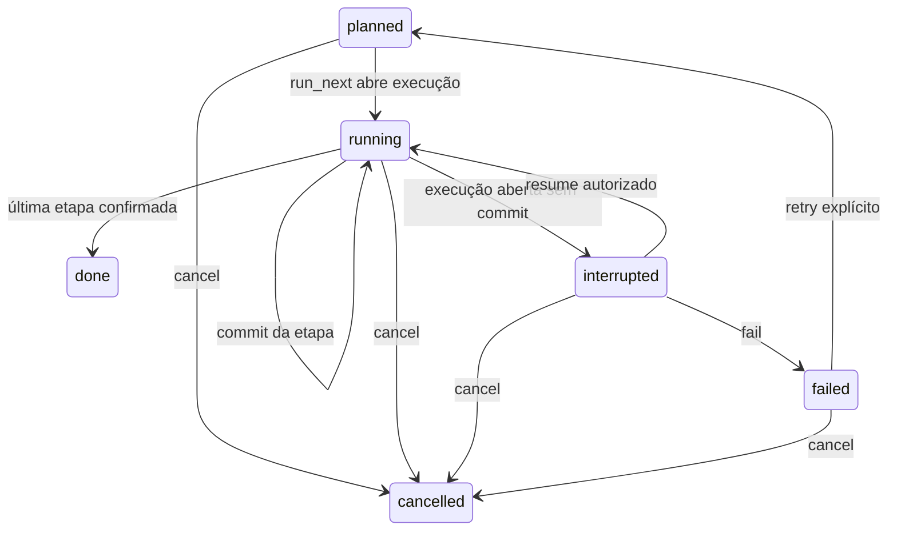

# ADR 007 — motor supervisionado de Missões

- Estado: proposta implementada para API local sintética, processo único.
- Data: 2026-09-25.
- Substitui, no servidor, a lista de transições do ADR 006. O DEMO do navegador não é este motor.

## Estados

O estado da missão continua no documento v1. `done` permanece o estado concluído; não há um segundo valor `completed`.

A etapa tem estado próprio. `done` da missão só ocorre quando todas as etapas estão `done` e cada uma tem artefato `draft` rastreável.

## HTTP

`POST /real/missions/{id}/transition` aceita `run_next`, `resume`, `fail`, `retry` e `cancel`, com `expected_revision` e `idempotency_key`. A resposta inclui `available_actions` calculadas pelo servidor. Grant de Calendar não autoriza. `mission:write` é revalidado de novo no commit do artefato, com o lock de concessão ainda retido até o fim da transação SQLite. Quem chega primeiro, cancelamento ou commit, fica confirmado. Uma execução que deixou de estar `open` não é concluída pelo `run_next` antigo. `resume` só confirma a fase `interrupted`.

A skill determinística não tem efeito fora do SQLite. Não há exactly-once para um efeito externo que viesse a ocorrer antes desse commit.

## Concorrência

Uma execução `open` por missão. A confirmação adquire primeiro o lock em memória das concessões e, ainda com ele retido, abre `BEGIN IMMEDIATE`. Essa é a mesma ordem das leituras de Calendar: concessão, depois SQLite. O cancelamento consulta a concessão antes da transação e não pega o lock de concessão dentro do SQLite, então as duas ordens não se invertem.

`run_next` só grava o artefato se a execução continua `open`, com a mesma revisão e a mesma identidade. `resume` só grava se ela continua `interrupted`. Cancelamento e `fail` fecham a execução `open` como `failed`; essa fase não pode ser concluída nem retomada. Se o cancelamento confirma primeiro, o commit seguinte responde 409, não grava artefato e não desfaz o cancelamento. Se o commit confirma primeiro, o cancelamento tardio com a revisão antiga responde 409 e o artefato já confirmado permanece. Quem usa a revisão nova cancela a missão sem reabrir a etapa.

A transição vencedora grava artefato, etapa, revisão e evento na mesma transação final. A outra recebe 409. Chave igual com corpo diferente também recebe 409.

## Interrupção

`run_next` confirma a linha `open` antes do trabalho determinístico. Se o processo morre nessa janela, o boot marca a execução e a missão como `interrupted` e não relança a skill. `resume` explícito, com grant vigente, conclui a mesma etapa. O identificador do artefato é estável para não duplicar.

## O que não é este motor

Não há fila, segundo worker, scheduler nem efeito externo. `fail` aqui é a ação explícita ou a falha da skill no processo vivo, não uma aprovação humana. Aprovar artefato continua só no DEMO do navegador.
