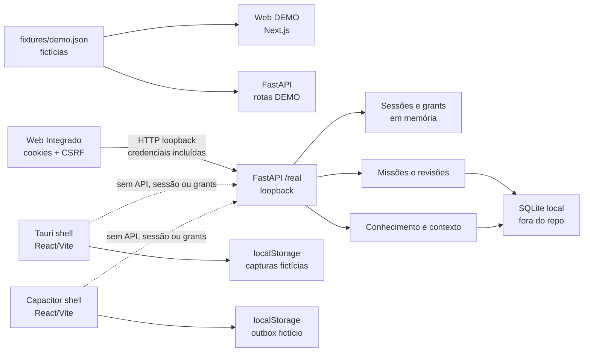
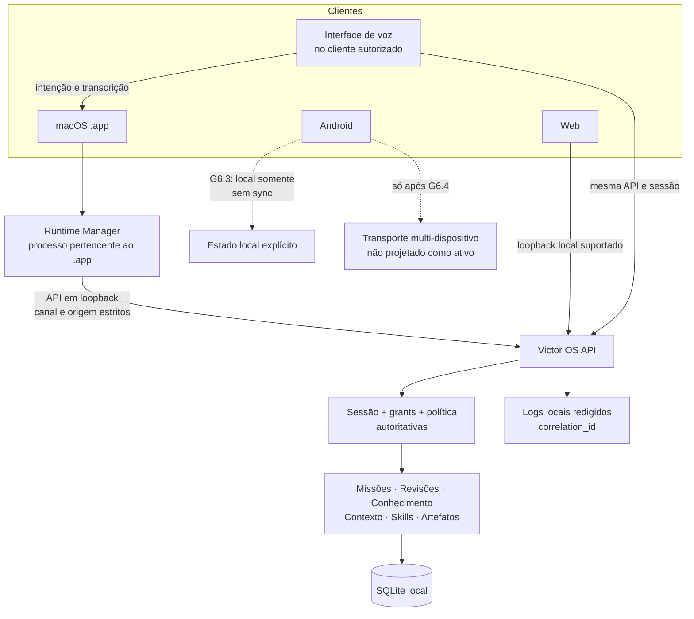

# Arquitetura G6

## Arquitetura atual verificada

O diagrama separa duas experiências que hoje não devem ser confundidas: fixtures DEMO da Web e a API local sintética conectada na jornada Integrado. O shell Tauri e o shell Capacitor não têm conexão funcional com a API.

**Rótulo importante do contrato atual:** respostas de sessão/caminhos /real usam o campo dataset com valor "real", embora os conectores e dados desta instância sejam sintéticos; o calendário informa provider_mode "simulated". Esse valor identifica a rota/dataset do backend local, não uma conta ou fonte externa real. A UI nativa deve rotular o estado como “API local · dados sintéticos” com proveniência, e não como conta real. Não reescrever o significado do campo antigo sem versionar contrato.

## Arquitetura de destino

O desenho multi-cliente não replica verificações de autorização. Cada cliente apresenta uma cópia de estado que pode ficar obsoleta; comandos protegidos sempre retornam ao servidor e carregam revisão/identificadores necessários para rejeitar estado antigo.

## Componentes e limites

| Componente | Autoridade | Estado que pode manter | Estado que não pode decidir |
|---|---|---|---|
| Web, Tauri, Capacitor | Apresentação, acessibilidade, coleta de intenção, estado transitório e cache explicitamente rotulado | Estado de navegação, rascunho local, estado de conectividade, voz efêmera | Validade de sessão, posse de grant, escopo de domínio, resultado de aprovação, confiança/proveniência de fonte |
| Victor OS API | Sessão, autorização, decisão de domínio, regras de missão, revisão, proveniência, contexto e acesso ao banco | Sessões/grants voláteis atuais; estado persistente de produto no SQLite | Identidade remota ou garantias contra administrador do host não aprovadas pelo ADR-010 |
| Runtime Manager (futuro) | Ciclo de vida do processo API filho e endpoint do próprio app | Handle do filho, porta e readiness em memória | Autorização de chamadas, aprovação de missão, descoberta de processos alheios |
| Serviço de voz (futuro) | Coordenação de entrada/saída de áudio permitida pelo SO | Estado efêmero de voz, buffer temporário e metadados mínimos | Aprovar side effects ou contornar grants |

## Contratos de confiança

1. O cliente não transforma `domain_id` em autorização; domínio classifica dados e só o servidor decide escopo.
2. O WebView conversa apenas com endpoint fornecido pelo runtime confiável e validado. Nenhum cliente procura qualquer serviço que responda na porta esperada.
3. O runtime abre o listener em loopback e limita a origem do WebView ao origin efetivo medido no build assinado. Não usar CORS `*`, `null`, rede local ampla nem `Access-Control-Allow-Origin` refletido.
4. Prontidão é um contrato interno do processo iniciado pelo app. O endpoint DEMO atual `/health` informa `mode=mock`; não é sinal de que as rotas `/real` ou o banco estão aptos.
5. Falha do backend preserva o dataset e a tela de erro. Não há fallback silencioso para fixtures.
6. A API existente não tem prefixo de versão nas rotas. O G6.1 deve congelar um snapshot OpenAPI e decidir compatibilidade de endpoints antes da primeira chamada autenticada do .app; mudanças incompatíveis precisam de migração explícita e contrato de versão.

## Mac: empacotamento e comunicação

Tauri 2 continua candidato por ser a base já adotada. O mecanismo documentado para incluir executável auxiliar é um sidecar Tauri; a documentação oficial descreve o uso de PyInstaller para empacotar servidor Python e requer alinhamento de binários por target. A invocação do processo passa por permissões/capabilities limitadas do plugin shell. Isso é uma direção de G6.1, não uma dependência instalada nesta sprint. [Tauri: sidecars](https://v2.tauri.app/develop/sidecar/) · [Tauri: shell plugin](https://v2.tauri.app/plugin/shell/)

O sidecar deve fazer bind em `127.0.0.1`, adquirir uma porta efêmera no próprio bind e anunciar readiness por canal controlado pelo processo pai. Não selecionar porta livre e soltá-la antes do bind. O runtime retém o handle do filho; não mata processos por nome nem por PID obtido em busca global.

Há uma incompatibilidade a resolver antes da integração: hoje o runner usa porta 8000 e a lista CORS inclui apenas as três origens de desenvolvimento web em loopback. A CSP Tauri permite IPC, não a API. O app empacotado tem origem diferente da Web de desenvolvimento. G6.1 precisa obter a origem real do WebView e ajustar CSP, allowlist da API e cliente com origens exatas, incluindo ensaio de preflight, cookies e CSRF. Nenhum curinga é aceitável.

## Android: limite de acesso

Em um aparelho Android, `127.0.0.1` designa o próprio aparelho. A API atual aceita bind apenas em loopback e não é endpoint LAN. Portanto, G6.3 não oferece acesso à API no Mac nem apresenta missões sincronizadas. O projeto Capacitor fornece um shell que pode receber capacidades nativas por plugin, mas isso não muda a fronteira de rede nem dá identidade ao dispositivo. [Capacitor: Android](https://capacitorjs.com/docs/android)

## Fontes de plataforma a validar na implementação

- Tauri v2 sidecar e shell plugin: configuração, triplet do binário, permissões de capability, assinatura e processo filho variam por plataforma e devem ser exercitados no artefato macOS produzido.
- Capacitor Android: integração nativa e requisitos do SDK devem ser confirmados quando G6.3 for autorizado; G6.0 não instala JDK, SDK ou plugin.
- Voice APIs: disponibilidade offline depende do reconhecedor/idioma/aparelho; a plataforma não garante capacidade offline para todo reconhecimento. [Apple Speech](https://developer.apple.com/documentation/speech/sfspeechrecognizer/supportsondevicerecognition) · [Android SpeechRecognizer](https://developer.android.com/reference/android/speech/SpeechRecognizer)
- Segredos futuros por dispositivo: Keychain/Keystore protegem chaves no aparelho, mas não constituem por si sós autenticação de conta, autorização, provisioning ou revogação. [Apple Keychain Services](https://developer.apple.com/documentation/security/keychain-services) · [Android Keystore](https://developer.android.com/privacy-and-security/keystore)

## Migração de dados e logs

O caminho atual do SQLite é persistente em Application Support no macOS e em XDG data home nas plataformas compatíveis. Ele fica fora do bundle. Antes de qualquer atualização com migração, o G6.1 deve definir cópia de segurança consistente, compatibilidade entre versões, falha recuperável e procedimento de recuperação que não sobrescreva a única cópia. Não copiar fixtures ao banco local.

Logs locais devem usar allowlist de campos: categoria, estado, timestamp, versão do app/API, correlation_id, mission_id, execution_id, device_id futuro e voice_session_id efêmero. Excluir token, passphrase, cookie, áudio, texto integral, corpo de missão e dados não necessários. A configuração atual do Uvicorn usa `access_log=False`; o runtime não pode religá-lo sem política explícita.
