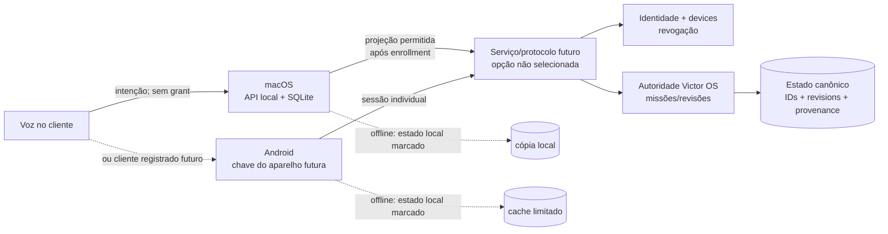

# Identidade e continuidade — desenho G6.4

## Estado atual

No G5 aceito, autenticação local por passphrase cria uma sessão em memória; CSRF acompanha mutações. Grants também são objetos em memória, coordenados por lock e associados ao principal local owner, recursos e domínios. TTL de sessão atual é 12 horas; grants têm limite máximo atual de 30 dias. Reiniciar processo elimina sessões e grants. domain_id classifica uma operação/memória e não dá acesso por si só. O usuário aceitou explicitamente o trust boundary local e sintético do ADR-010.

O Android atual não tem device identity, sessão remota ou conta. Não existe conversation_id persistente compartilhado: a interface Conversa web é local à jornada apresentada e os shells guardam rascunhos próprios.

## Vocabulário que G6.4 deve preservar

| Conceito | Pergunta respondida | Fonte autorizada | Persistência atual |
|---|---|---|---|
| Identity / identidade de produto | Quem é a pessoa/entidade no sistema de continuidade? | Nenhuma conta remota atual. owner é principal local sintético, não ID de conta. | Não existe modelo remoto. |
| Authentication | Que prova permite iniciar sessão para uma identidade? | Passphrase local no backend atual. | Verificador/configuração fora do DB conforme ambiente; sessão volátil. |
| Authorization | Esta operação é permitida agora neste recurso/domínio? | API valida sessão e grants para cada operação. | Não delegar ao client; política e conteúdo de negócio persistem no backend. |
| Device identity | Qual dispositivo registrado apresentou prova criptográfica? | Ainda não existe. ID legível sozinho não é prova. | Deve ser projetada antes de remote. |
| Session | Qual contexto de autenticação temporário e renovável está ativo? | API cria/expira e valida. | Memória volátil no G5. |
| Grant | Qual recurso e domínio a sessão pode acessar, com prazo/revogação? | API cria, lê, revoga e checa; domain_id sozinho não basta. | Volátil hoje; sem restauração a partir de UI/cache. |
| Conversation | Continuidade de interação com histórico e política de retenção. | Não há entidade compartilhada de produto hoje. | Parcial/local por cliente; não sincronizável. |
| Voice session | Uma captura de voz transitória e seu ciclo de vida. | Cliente coordenador, sem direitos de negócio. | Efêmera; ID de correlação, descartável. |

## Semântica dos identificadores

| ID | Autoridade | Persistente? | Local? | Sincronizável no futuro? |
|---|---|---:|---:|---:|
| mission_id | Banco/Victor OS que criou a missão | Sim no DB da instância | Sim hoje | Sim somente se G6.4 escolher continuidade e preservar autoridade/revisões |
| artifact_id | Missão e versão de artefato no DB | Sim no DB | Sim hoje | Referência pode sincronizar; conteúdo precisa de política própria |
| approval_id / review_id | API de revisão, ligado a artifact_id + versão/hash | Sim no DB | Sim hoje | Estado e decisão podem sync apenas com semântica de conflito e identidade aprovadas |
| conversation_id | Serviço de conversa futuro | Não existe hoje | Futuro | Candidato, sujeito a retenção e escopo de domínio |
| device_id | Processo de provisioning futuro | Não existe hoje | ID opaco local/remoto | Sim como identidade registrada, nunca como autorização isolada |
| session_id | API de autenticação futura | Atual sessão identificada por token opaco/cookie, mantido em memória | Local hoje | Não sincronizável; cada aparelho/sessão precisa autenticação e revogação próprias |
| grant_id | API local atual | Existe durante o processo | Local/volátil | Não é portável. Futuro grant precisa sujeito, recurso, domínio, expiração e revogação no servidor. |
| voice_session_id | Gerenciador de voz do cliente | Efêmero | No aparelho | Nunca sincronizar áudio; pode correlacionar erro curto, sem token |
| correlation_id | Cliente gera opaco ou API gera | Curta duração de observabilidade | Por request | Pode atravessar API somente para rastrear request; não representa pessoa/dispositivo |

Todos IDs são referências, não credenciais. Cliente não fabrica um ID para alcançar objeto de outra identidade; servidor resolve objeto com sujeito e autorização atuais.

## Keychain e Keystore: função e limite

Para um futuro gate, abstrair secure storage por aparelho e nunca acoplar domínio de produto diretamente a API de plataforma:

```ts
interface DeviceKeyStore {
  createKey(purpose: string): Promise<{ keyId: string; publicKey?: string }>;
  sign(keyId: string, challenge: Uint8Array): Promise<Uint8Array>;
  deleteKey(keyId: string): Promise<void>;
}
```

No macOS, avaliar Keychain Services; no Android, Android Keystore pode controlar uso de chave e manter material criptográfico não exportável. Esses mecanismos podem guardar uma chave privada ou segredo local e exigir autenticação de usuário, mas não determinam por conta própria qual identidade controla a chave, como ocorre enrollment/pareamento, quais grants existem, como servidor revoga aparelho, nem como recuperar conta perdida. [Apple Keychain](https://developer.apple.com/documentation/security/keychain-services) · [Android Keystore](https://developer.android.com/privacy-and-security/keystore)

O G5 não declara Keychain/Keystore como trust root e não os usa. Se G6.4 adotar chaves por aparelho, trust root deve ser um protocolo de enrollment e autorização que o backend valida fora do SQLite canônico; deve haver rotação, revogação, recuperação e auditoria de desafio. Isso muda o threat model e demanda novo aceite. Segurança do secure storage do OS reduz extração em certos cenários; não protege contra todo processo executado sob o mesmo usuário, aparelho comprometido ou administrador do host.

## Modelo de continuidade sem falsa sincronização

Uma missão é compartilhável apenas após vínculo entre principal/identidade, instâncias, armazenamento de artifact snapshots e regras de autoridade. O cliente Android local não deve gerar um mission_id e declarar que abriu a missão do Mac. Antes de G6.4:

- uma lista local é local e editável localmente;
- missão de Mac é inacessível pelo Android;
- approval cacheado é somente leitura e stale se futuro modo offline o permitir;
- conteúdo não entra em outbox silenciosa;
- reconexão não reproduz mutações pendentes sem confirmação e idempotência do servidor.

### Desenho multi-dispositivo futuro — ainda não aprovado



As setas pontilhadas/rotuladas representam cenários que não existem no G6.0; nenhum transporte é criado por este desenho. A fonte canônica, regra de cópia e conflito, authorization, retenção e transporte são decisões de G6.4.

Fluxo futuro ilustrativo: Mac cria missão na autoridade; identificador é resolvido pela identidade autenticada; Android recebe uma projeção com proveniência e versão; ação mutável é submetida novamente à mesma autoridade e validada contra revisão/hash atual; conflitos não sobrescrevem silenciosamente.

## Itens de aceite do G6.4

O gate deve aprovar: entidade de identidade, principal e device, chave/provisioning, autenticação, sessão, grant, seleção de domínio, logout/revogação, perda de dispositivo, recuperação de conta, retenção de conversa/voz, arquivo sincronizado, conflito de missão, aprovação stale, offline e custos recorrentes. Sem resposta segura para cada item, multi-dispositivo permanece desabilitado.
