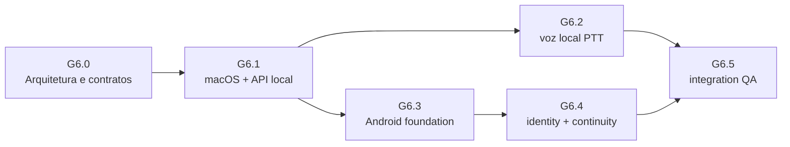

# Sequência de implementação

## Ordem recomendada

### Justificativa

G6.1 vem primeiro porque confirma contratos no cliente nativo mais próximo da autoridade local atual e resolve sidecar, origins, readiness, restart, banco e logs. G6.2 depende de cliente conectado e de fluxo de aprovação confiável; voice adiciona risco de captura e confirmação, então não deve preceder a integração/API. G6.3 pode construir UX e modelo offline após OpenAPI congelado, mas continua Foundation desconectado. G6.4 antecede qualquer sync entre Android e Mac, pois é uma nova trust boundary com identity, revogação e recovery. G6.5 fecha os caminhos integrados e só pode declarar continuidade se G6.4 tiver sido aceito.

G6.3 pode executar em paralelo com refinamento visual de voz depois do contrato G6.1, mas não deve integrar rede enquanto G6.4 está aberto. A sequência não autoriza subgates automaticamente.

## Próximo PR implementável: G6-MAC-001

**Título sugerido:** `feat(desktop): add supervised local runtime sidecar foundation`

**Objetivo pequeno:** provar que o .app inicia, reconhece readiness, encerra e limpa um processo auxiliar que ele próprio iniciou, antes de apontar para rotas autenticadas da API de produto.

**Escopo do PR:**

1. Instalar dependência Tauri shell/process necessária somente após confirmar permissões e superfície. Configurar capability com executável sidecar e argumento fixo; nenhuma interpolação de input do WebView em shell command.
2. Adicionar módulo Rust Runtime Manager que retém child handle, emite estados Starting/Ready/Degraded/Stopping e observa saída/crash.
3. Usar um executável de teste determinístico que informa readiness e aceita shutdown cooperativo; ele não acessa SQLite nem fornece endpoints de missão. Empacotar e executar o bundle local macOS suportado.
4. Validar instância concorrente, child falso, timeout, falha e encerramento. O runtime não busca processo global e não mata PID alheio.
5. Documentar resultado do build/target, limites de assinatura e decisão DEC-01/02. Não integrar CORS/API até DEC-03/04/05 serem resolvidas.

**Arquivos prováveis:** apps/desktop/package.json, apps/desktop/src-tauri/Cargo.toml, tauri.conf.json, capabilities/default.json, src/lib.rs, novo src/runtime_manager.rs, sidecar fixture e testes Rust.

**Dependências:** macOS host/toolchain e runner de build disponíveis; decisão de empacotamento do fixture; revisão da capability. Não requer Android SDK.

**Aceite do PR:** app .app inicia um único fixture child próprio; readiness comprovada por handshake e timeout; finalização fecha esse child; nenhum socket externo, DB ou endpoint de produto acessado; capability não executa comando arbitrário; testes documentados reproduzíveis.

**Risco principal:** escolher um mecanismo de teste que não representa empacotamento real do servidor. Registrar como spike descartável e evitar apresentar o PR como conexão funcional. O primeiro PR após esse spike será integração do runner FastAPI e deverá fechar origin/CORS/readiness antes de enviar cookies.

## Ordem de backlog depois do spike

1. G6-MAC-002: resolver endpoint dinâmico e origin Tauri em bundle.
2. G6-MAC-003: empacotar runner FastAPI real, health/readiness distinto e API client gerado.
3. G6-MAC-004: estados de sessão, grants, missão, aprovação e dataset iguais à Web.
4. G6-MAC-005: atualizar/migrar SQLite em backup sintético, encerramento/crash e logs.
5. Aceitar G6.1 antes de ativar microfone no produto.
6. G6-VOICE-001+: PTT e providers após decisões de dados/custo/locale.
7. G6-AND-001+: fundação Android offline/local após contrato.
8. G6-ID-001+: nenhuma continuidade real até G6.4 aprovado.
9. G6-QA-001+: matriz comparativa e acessibilidade G6.5.

## Sequência de validação por PR

- Manter dados sintéticos e DB temporário em probes/testes.
- Verificar testes direcionados de lifecycle e boundary com stdout/exit code registrados.
- Para PR que toca API, executar regressão API, Vitest, typecheck, lint e build web conforme AGENTS; cada ambiente nativo só após toolchain autorizada e documentada.
- Rodar E2E de desktop/mobile sem retry para os subgates conectados.
- Revisar origens/datasets em screen capture, estado de acessibilidade e logs redigidos.
- Atualizar threat model e decisões pendentes conforme evidência, sem converter sucesso local em aprovação de conta/remoto.
