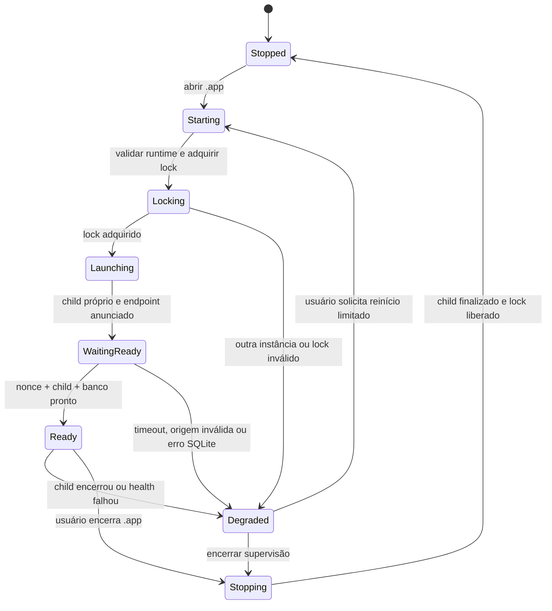

# Runtime macOS — desenho do G6.1

## Estado atual

`apps/desktop` é uma janela Tauri 2 com React/Vite. `src-tauri/src/lib.rs` cria apenas `tauri::Builder::default()`; a capability concede somente `core:default`. Não existe comando Tauri, plugin shell, sidecar, endpoint da API, sessão ou acesso SQLite. O frontend permite capturas fictícias no localStorage e informa que Missões/Aprovações não estão conectadas.

A API oficial sobe por `python serve.py`, valida bind em `127.0.0.1` ou `::1`, usa porta 8000 por padrão, desativa access log e constrói a app com configuração explícita. `main.py` não exporta app global para impedir bypass do runner. A origem permitida hoje contempla somente `localhost:3000`, `127.0.0.1:3000` e `[::1]:3000`; CSP Tauri atual autoriza IPC, sem conectar à API.

## Respostas de runtime

| Pergunta | Direção para G6.1 |
|---|---|
| Quem inicia API? | Runtime Manager da janela/app Tauri inicia um sidecar empacotado do servidor oficial. Um launcher assinado inicia um processo filho próprio. |
| Conectar a processo preexistente? | Não. Não procurar listener, PID ou nome de processo. Não anexar a servidor iniciado fora do .app. |
| Impedir dois backends? | Uma única instância de .app, lock exclusivo em diretório privado de Application Support e uma única referência ao child handle. Lock coordena instâncias cooperantes; o pai deve validar que a instância retida continua viva. |
| Descobrir porta/processo? | O processo filho faz bind diretamente em endereço loopback e porta efêmera. Comunica porta/nonce de runtime por canal local controlado (stdout estruturado ou pipe). Não sondar portas e não usar “achar livre, soltar, reabrir”. |
| Health/readiness? | O parent exige resposta assinada por nonce de execução e confirmação do child, com limite de tempo. A prontidão confirma inicialização SQLite/migrações. O endpoint DEMO atual `/health` que retorna `mode=mock` não atende. |
| Encerrar? | Ao sair normal: pedir shutdown cooperativo pelo canal do child; aguardar prazo curto; terminar somente o child controlado pelo handle; aguardar encerramento. Nunca sinalizar PID obtido de arquivo sem conferir propriedade do processo. |
| Crash? | Estado `Degraded`; uma tentativa de reinício supervisionada após aviso/ação definida. Sem loop infinito. Reabrir sessão explicitamente após reinício do servidor porque sessões/grants são voláteis. |
| Banco? | Permanece em Application Support, fora do bundle. Fazer backup consistente e teste de migração/rollback operacional antes de atualizar schema. Nunca substituir banco por fixture. |
| DEMO vs API? | Renderizar `dataset`, `provider_mode` e conectividade recebidos. Não inferir “real” porque HTTP respondeu, nem fallback para DEMO quando a API cair. |
| Logs? | Eventos estruturados locais e minimizados. Sem access log HTTP, cookies, tokens, passphrase, áudio, prompts ou conteúdo sensível. |
| Exposição? | Bind somente loopback, validação host/client da API, CSP restrita, CORS e verificação Origin exatos, sem LAN, túnel ou bind global. |

## Diagrama de ciclo de vida

## Handshake e porta

O G6.1 deve escolher uma única forma de entrega segura do endpoint. Recomendação de implementação: alocar a porta no próprio bind do child, que permanece dono do socket; depois informar a porta e um nonce aleatório de instância ao parent em um canal de pipe/stdout sem conteúdo de usuário. O parent envia desafio de readiness ao mesmo processo e confere resposta e estado do handle antes de carregar UI conectada. Não armazenar segredo longo em configuração, URI, localStorage ou logs.

Porta dinâmica muda a URL e pode ser bloqueada pela política de origem do WebView. Antes de habilitar cliente autenticado, ensaiar no artefato .app a origem de produção efetiva, cookie, SameSite, Origin, CORS preflight, CSP e CSRF. O atual origin allowlist é insuficiente para o app. Escolher origem explícita ou bridge nativa após teste; não liberar host/cors curingas como atalho. Qualquer bridge deve expor apenas o conjunto de operações necessário, validar tipos no servidor e não virar autorização no Rust.

## Empacotamento e atualização

Tauri 2 permite incluir sidecars com nomes vinculados ao target. A documentação oficial cita PyInstaller para servidores Python e exige configuração do executável externo e integração do plugin shell com permissões. G6.1 valida arm64 e x86_64 necessários ao plano de distribuição; universal binary só depois de medir tamanho e compatibilidade. [Tauri sidecars](https://v2.tauri.app/develop/sidecar/) · [Tauri shell plugin](https://v2.tauri.app/plugin/shell/)

Plano de build:

1. congelar dependências Python com lock atual e produzir um sidecar repetível em CI local;
2. testar startup, shutdown, readiness e crash dentro de um bundle de desenvolvimento;
3. revisar assinatura e notarização antes de distribuição, sem assumir que custo de certificação é zero;
4. manter banco em diretório de dados, com backup anterior à migração e diagnóstico seguro;
5. testar upgrade N para N+1 e recuperação em cópia sintética;
6. documentar como remover somente binários/logs temporários sem apagar banco do usuário.

O caminho e política atuais de SQLite são descritos em `apps/api/memory_store.py`; o processo de aplicação inicializa migrações na subida. Atualização reversível de schema não deve ser pressuposta.

## Sessão e grants após reinício

Sessões e grants ficam em memória em `apps/api/local_security.py`; o reinício invalida ambos. UI precisa apresentar “Sessão encerrada pelo reinício local”, manter somente rascunhos não sensíveis que o usuário não submeteu, pedir autenticação local e solicitar grants de novo. O cliente não pode preservar token ou grant em Keychain/SQLite para reidratar silenciosamente uma autorização antiga.

## Checklist obrigatório G6.1

- [ ] Um único .app e um único child gerenciado após duas tentativas concorrentes.
- [ ] API escuta somente loopback; probe LAN falha.
- [ ] Porta em uso por processo externo resulta em seleção/erro seguro, sem conectar ao processo externo.
- [ ] Processo falso não passa readiness nonce.
- [ ] Falha/crash do child mostra estado e não muda para DEMO.
- [ ] Fechar janela/app encerra somente o child iniciado por esta instância.
- [ ] Origin/CSP/cookie/CSRF funcionam no bundle assinado com allowlist exata.
- [ ] SQLite existente é preservado; sessão/grants exigem reautenticação após restart.
- [ ] Logs não contêm segredo, conteúdo de missão ou dados de áudio.
- [ ] Backup e atualização são ensaiados em banco sintético temporário.
