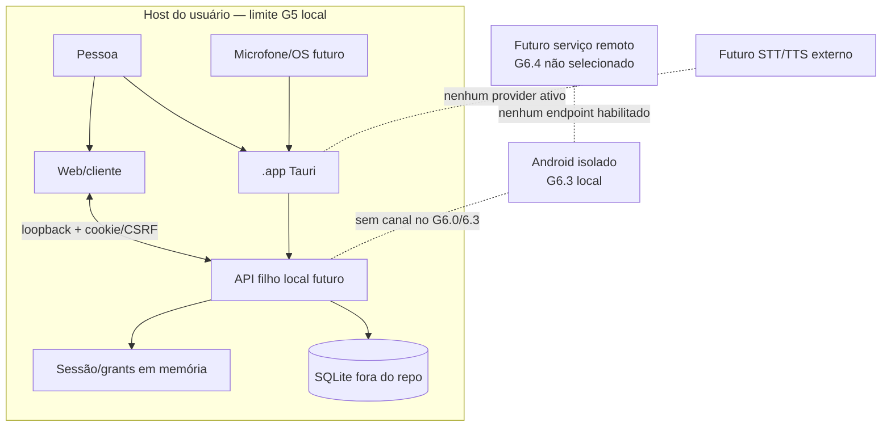

# Threat model — G6

## Escopo e ativo protegido

Este modelo amplia por planejamento o boundary local G5. A implementação G6.0 não altera o boundary aceito nem ativa clientes conectados. O sistema atual processa dados sintéticos locais. Ativos futuros de atenção: sessão, grants por recurso/domínio, SQLite local, revisões/decisões de artefato e conhecimento com proveniência, estado de runtime, áudio/transcrição, chaves do dispositivo, continuidade entre clientes e integridade da decisão humana.

### Fronteiras

## Modelo G5 aceito

As garantias aceitas no ADR-010 são locais, sintéticas e de um processo. Runner valida bind loopback; middleware valida host/client loopback e CORS é restrito a origens web de desenvolvimento; sessões/grants são voláteis e grants são coordenados no processo; autorização protegida é validada no servidor; SQLite local é fonte persistente de missões e proveniência. A aceitação não oferece proteção criptográfica contra administrador do host, acesso remoto, multiworker, provedor real ou continuidade remota.

Um usuário/processo suficientemente privilegiado no mesmo host pode inspecionar/alterar runtime, memória ou DB; não afirmar o contrário. Os clientes nativos devem preservar as condições G5 e não reinterpretá-las como autenticação de produto.

## Ameaças introduzidas por G6.1 macOS

| Ameaça | Efeito | Mitigações e prova exigida |
|---|---|---|
| API bind em interface de rede | Dados locais expostos à LAN/internet. | Bind constante em loopback, validação no runner e middleware, teste de bind/probe LAN no pacote. |
| Processo malicioso ocupa porta fixa | .app conecta a serviço impostor e envia cookie/CSRF. | Não adotar processo alheio; bind de porta efêmera feita pelo child; handshake por nonce, child handle e origem exata; prova negativa contra processo falso. |
| Corrida ao escolher porta | Serviço externo captura a porta entre probe e bind. | Eliminar probe-then-bind; child mantém socket que o SO alocou. |
| Origin/CSP permissivos | Site ou conteúdo embutido envia comandos para API local. | Origin de app observado no build; CORS exact allowlist; CSP estreita; validar Origin, Host, CSRF e cookies; teste com origin recusado e preflight. |
| Comando Tauri excessivo | WebView invoca shell arbitrário/abre processo. | Capability concede apenas comando sidecar de caminho e argumentos fixos; sem string de shell; revisão do plugin e lista de permissões. |
| Filho órfão ou morte de processo errado | API permanece ativa ou processo do usuário termina. | Guardar handle; shutdown cooperativo; terminar somente filho próprio; teste de duas instâncias, app kill e crash. |
| Portas/processos simulados como readiness | UI marca app pronto sem banco, ou abre falso serviço. | Prova nonce de execução via canal local, health/readiness distinto, validar DB inicializado e versão. |
| Migração interrompida/rollback inseguro | Corrupção ou perda de SQLite. | Backup consistente antes de migration, ensaio de upgrade e recuperação em cópia sintética; preservar originais. |
| Sessão reaproveitada após restart | UI acredita que grants ainda valem. | Processo informa novo epoch; sessão/grants invalidados; pedir login e grants novamente. |
| Log captura segredo ou conteúdo | Exposição local de passphrase, missão, cookie ou voz. | Allowlist de campo, access log desligado, redaction e inspeção dos logs de erro/crash. |
| Atualização de bundle adulterada | Execução de sidecar não esperado. | Assinatura, notarização e cadeia de build verificadas antes da distribuição. |

## Android/remoto — fronteira futura ainda sem aceite

O scaffold Android não abre canal ao Mac e não usa API remota. Ameaças que surgem ao cruzar essa linha incluem roubo de sessão/token, replay, TLS/endpoint falso, aparelho perdido, provisioning fraco, revogação offline, extração em aparelho comprometido, sync conflitante, replay de mutação e leak via push. Só G6.4 pode selecionar transporte, e deve incluir modelo de identidade, chaves, revogação, retenção, backup, recuperação, limites offline, concorrência e incident response. G6.0 não conclui que opções de relay, cloud ou P2P são seguras.

## Voz

| Ameaça | Mitigações requeridas no desenho |
|---|---|
| Falsa/accidental activation | Push-to-talk deliberado, primeiro plano, sem wake word, indicador visível, botão cancelar/mute. |
| Replay de gravação | Não aceitar áudio como credencial nem como aprovação; ação sensível exige aprovação interativa e backend revalida. |
| Transcrição mal compreendida | Mostrar transcript final para revisão antes de envio; destacar confiança baixa; permitir editar/cancelar; nenhuma mutation em transcript parcial. |
| Confirmação acústica incorreta | “Sim” não decide. Aprovação exige tela de revisão e sessão/grant válidos; voice-session-id não concede direito. |
| Permissão/background recording | Pedir permissão contextual, operar em foreground, cortar captura ao perder foco/permissão e mostrar o estado do sistema. |
| Transcript sensível | Não guardar sem ação e política de retenção; não logar; limpar buffer temporário; não expor em lock-screen/TTS público. |
| Saída TTS vaza conteúdo | Notificação neutra, controle de parada e política para conteúdo restrito; nunca narrar segredo sem escolha contextual. |
| Provider de voz recebe conteúdo | Provider externo é outro boundary; não habilitar antes de análise de dados, custo, consentimento, contrato e retenção. |
| Barge-in repete side effect | Cancelar voz não significa cancelar decisão já recebida; consultar estado/idempotência antes de novo envio. |

## Logging e correlação

Permitidos após minimização: timestamp, categoria, status, build/API version, correlation_id, mission_id, execution_id, device_id após enrollment, voice_session_id aleatório e duração/latência. Não registrar passphrase, senha, token, cookie, grant secreto, áudio bruto, transcript por default, conteúdo de artefato ou corpo de requisição. Error reporting sem envio externo no protótipo.

## Risco residual aceito vs. bloqueador

- **Aceito no G5:** confiança no host e admin local conforme ADR-010; processos no mesmo usuário não são isolados por criptografia de rede; sessions/grants voláteis monoprocesso.
- **Bloqueador para G6.1:** CORS/Tauri origin não resolvido; processo falso/colisão; readiness confundida com DEMO; acesso fora de loopback; life cycle que deixa filho ativo; atualização capaz de sobrescrever DB.
- **Bloqueador para G6.2:** aprovação acústica, background mic, áudio/transcript guardado sem política ou comando mutável sem revisar transcrição final.
- **Bloqueador para Android conectado:** qualquer endpoint LAN/remoto, identidade improvisada, tokens em localStorage, sync de approvals stale ou push sem threat model.
