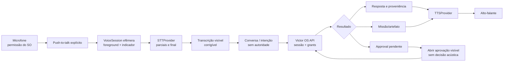
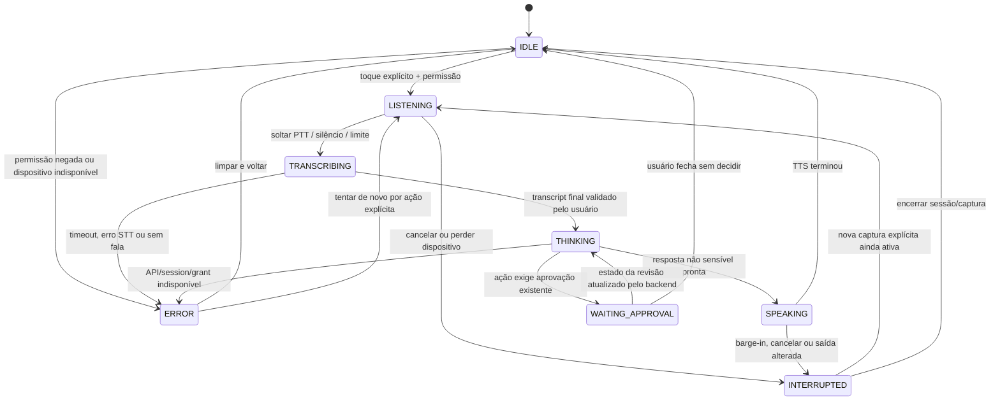
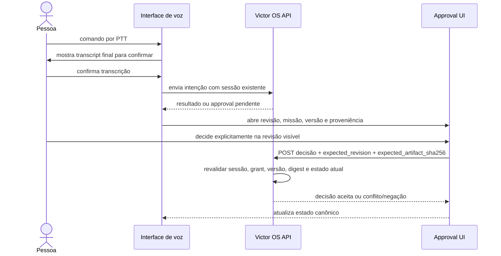

# Arquitetura de voz — G6.2

## Princípios

Voz é uma modalidade de entrada e saída do mesmo JARVIS. Ela usa a conversa, API, sessão, grants, missões, revisões e provenance já existentes. Não existe agente de voz com ferramenta ou autorização própria.

G6.0 projeta apenas. A implementação futura começa com push-to-talk, acionado pelo usuário em primeiro plano. Não há wake word, microfone acessado ou STT/TTS real habilitado nesta sprint. A capacidade offline varia por API, idioma e dispositivo; precisa ser verificada em cada plataforma antes de prometer uso offline.

## Pipeline



## Máquina de estados



### Definição operacional dos estados

| Estado | Significado visível | Regras |
|---|---|---|
| IDLE | Microfone inativo; sem captura aberta. | Não escuta em background. Botão PTT inicia. |
| LISTENING | Captura ativa; indicador persistente visível. | Áudio vai para buffer temporário do provider escolhido; mute/cancel sempre acessível. |
| TRANSCRIBING | STT conclui ou atualiza texto parcial. | Parciais ficam marcadas como provisórias. Nenhuma chamada de missão é emitida ainda. |
| THINKING | Texto final confirmado está sendo enviado/processado. | Mostrar que conteúdo será enviado ao backend local/provider conforme gate. Sem repetição automática de comando mutável. |
| SPEAKING | TTS toca resposta. | Botão parar e barge-in param a saída imediatamente; conteúdo sensível não deve ser dito se ambiente privado não estiver confirmado. |
| INTERRUPTED | Entrada ou saída foi cancelada, dispositivo mudou ou foco/áudio foi interrompido. | Cancelar stream TTS/STT e operação cancelável; não descartar side effect já confirmado pelo servidor sem consultar estado. |
| WAITING_APPROVAL | API informou aprovação pendente. | Mostrar qual missão, artefato, versão, digest, ação e escopo. Áudio não aprova. |
| ERROR | Erro recuperável com categoria segura. | Não cair em DEMO. Preservar apenas rascunho efêmero conforme política e permitir descartar/retry explícito. |

## Transições delicadas

### Barge-in

Quando o usuário interrompe SPEAKING:

1. parar o buffer de TTS local imediatamente;
2. cancelar o fluxo de TTS/provider;
3. marcar a fala anterior como interrompida, não como resposta concluída;
4. se o PTT continua explicitamente ativo e permissão/foco permanecem, transicionar para LISTENING;
5. caso contrário, transicionar para IDLE;
6. se havia mutation request já enviada, consultar resultado/idempotency e estado do servidor; não reenviar apenas porque a frase foi cortada.

### Approval



A fala “sim”, “aprovar” ou qualquer classificação probabilística apenas pode indicar que o usuário quer abrir/selecionar uma opção. No contrato inicial de G6.2, decisão sensível exige controle explícito na tela da revisão autenticada. A API decide e revalida; confirmação visual tampouco substitui autorização de servidor.

## Interfaces propostas

```ts
type VoiceSessionId = string; // opaco, efêmero, sem capacidade de autorização
type VoiceState =
  | "IDLE" | "LISTENING" | "TRANSCRIBING" | "THINKING"
  | "SPEAKING" | "INTERRUPTED" | "WAITING_APPROVAL" | "ERROR";

interface STTProvider {
  start(options: { locale: "pt-BR"; signal: AbortSignal }): Promise<void>;
  onPartial(listener: (text: string) => void): () => void;
  finish(): Promise<{ transcript: string; confidence?: number }>;
  cancel(): Promise<void>;
}
interface TTSProvider {
  speak(text: string, options: { locale: "pt-BR"; signal: AbortSignal }): Promise<void>;
  stop(): Promise<void>;
}
interface VoiceProvider {
  stt: STTProvider;
  tts: TTSProvider;
  capabilities(): Promise<{ onDeviceSTT: boolean; locale: string[] }>;
}
```

Os tipos expressam interfaces futuras; não existem implementações adicionadas neste commit. Adapters possíveis: voz do sistema operacional, provider externo avaliado em outro gate e voz licenciada/autorizada. Para voz baseada em pessoa real, obter licença ou autorização apropriada e registrar escopo/validade. Não clonar voz, gerar modelo ou baixar amostras nesta linha de trabalho.

## Privacidade, interrupção e falhas

- Solicitar permissão no primeiro uso, em contexto, e informar uso do microfone antes de abrir.
- Captura apenas em primeiro plano com PTT, indicador visível e controle cancelar/parar.
- Buffer de áudio efêmero; áudio bruto não é guardado por padrão, nem em crash report.
- Transcrição parcial é provisória; exigir revisão visual antes de enviar comandos que possam criar/alterar missão.
- Limpar texto de voz temporário ao encerrar, exceto conversa explicitamente salva pelo usuário na política do produto.
- Timeout de fala/silêncio fecha captura e explica o motivo.
- Mudança de saída, Bluetooth desconectado ou interrupção do SO para TTS e apresenta o estado.
- Estado de erro não reconecta à rede nem muda dataset silenciosamente.
- TTS não narra transcript, domínio restrito ou conteúdo sensível em notification lock screen; o cliente solicita confirmação de privacidade ou mostra somente notificação neutra.
- Voz em navegador Web não ganha permissão antecipada ou captura de fundo por conveniência.

## Custo e disponibilidade

Uma demo de arquitetura não gera custo recorrente e não ativa provider. Uma prova futura com voz de sistema pode não ter tarifa direta de API, mas pode exigir recursos do aparelho e a disponibilidade offline muda por idioma e SO. Provider remoto de STT/TTS, processamento, armazenamento, relay, push e hosting podem cobrar e transmitir dados. O custo e o caminho de dados devem ser aprovados antes de qualquer provider real.

Fontes oficiais para validação por gate: [Apple Speech recognition](https://developer.apple.com/documentation/speech/sfspeechrecognizer/supportsondevicerecognition), [Apple AVSpeechSynthesizer](https://developer.apple.com/documentation/avfaudio/avspeechsynthesizer), [Android SpeechRecognizer](https://developer.android.com/reference/android/speech/SpeechRecognizer) e [Android TextToSpeech](https://developer.android.com/reference/android/speech/tts/TextToSpeech).
