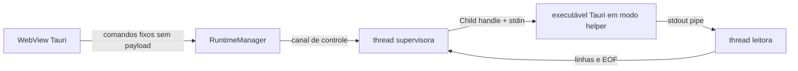

# Ownership de processos — G6-MAC-001

## Relação de propriedade

O supervisor recebe o valor `Child` por movimento e é a única parte que chama `try_wait`, `kill` e `wait`. A thread leitora só possui stdout e envia eventos por canal. O PID vai ao snapshot para leitura; nunca é usado com `kill(pid)`, busca de nome ou inspeção de arquivo de PID.

## Lançamento

- Binário: executável da aplicação atual (`current_exe`).
- Argumentos de produção: switch interno `--jarvis-runtime-test-helper`, ID atual e `normal`.
- Ambiente: limpo (`env_clear`).
- I/O: stdin/stdout pipados; stderr nulo.
- Shell, plugin shell e dependência de processo: inexistentes.
- Processos descendants: o helper não cria nenhum.

O caminho alternativo para iniciar `target/release/desktop` existe exclusivamente no teste ignorado de prova pós-build; não existe campo, command ou entrada correspondente no build de produção.

## Parada e recolha

O manager envia stop pelo pipe privado. O supervisor aguarda a saída com prazo limitado, termina apenas o processo associado ao `Child` se necessário e sempre chama `wait()` para recolher status. Não encontra nem encerra processo externo. A matriz testa um segundo helper independente durante start/stop/restart do child gerenciado.

Saída normal do Tauri chama `stop_and_wait`; `Drop` também tenta encerrar. Um encerramento forçado do processo pai pode ignorar os dois caminhos e permanece risco residual. Garantias para a API ou árvore de processos futura exigirão contrato próprio de MAC-003.

## Acesso de UI

A seção de runtime está visível para validação local. Cada ação é um nome fixo de comando Tauri. Ela não consegue especificar um executável, shell, argumentos, diretório de trabalho ou variáveis de ambiente. Em preview web os controles ficam indisponíveis. A capability existente permanece `core:default`; nenhum plugin/permissão de shell foi adicionado.
