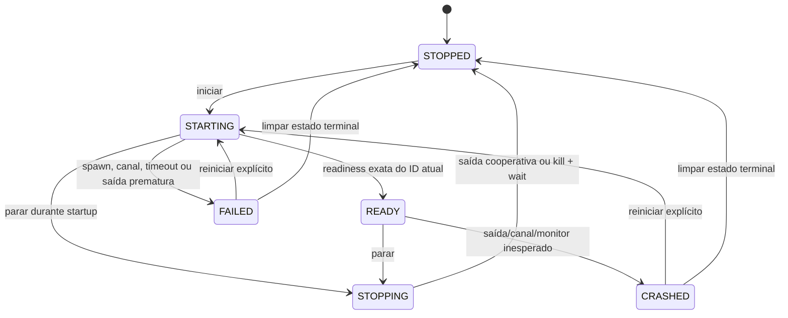

# Runtime Manager — máquina de estados

## Estados observáveis

| Estado | Significado | Ações disponíveis |
|---|---|---|
| `STOPPED` | Não há helper ativo nem child sob supervisão. | Iniciar. |
| `STARTING` | O child foi criado e o supervisor aguarda readiness válida. | Parar. |
| `READY` | Linha exata de readiness da instância atual foi validada; o supervisor envia o ACK imediatamente em seguida. | Parar. |
| `STOPPING` | Foi enviado pedido cooperativo; o supervisor aguarda saída ou timeout. | Parar idempotente. |
| `FAILED` | Falha antes da prontidão, inclusive spawn, canal ou timeout de startup. | Reiniciar explicitamente. |
| `CRASHED` | O processo terminou ou perdeu o canal após ficar pronto. | Reiniciar explicitamente. |

## Transições permitidas

`start` só é permitido em `STOPPED`; chamadas duplicadas durante startup/prontidão são rejeitadas e não criam outro child. `restart` só é permitido em `FAILED` ou `CRASHED`, sempre com novo ID. Não existe retry automático. `stop` repetido é idempotente.

## Comportamento de falhas

- Startup vence em 5 s na configuração de produção: mata pelo handle e recolhe com `wait()`.
- Saída antes de readiness produz `FAILED`; saída inesperada depois de readiness produz `CRASHED`.
- Fechamento/falha de stdout antes de prontidão produz `FAILED`; depois de prontidão produz `CRASHED`.
- Após aceitar readiness, o manager escreve o ACK no pipe; se a escrita falhar, encerra o child e marca `CRASHED` com `readiness_ack_failed`.
- Stop em startup ou pronto passa a `STOPPING`, escreve comando de parada e aguarda até 700 ms.
- Se o child não sair no prazo, o supervisor mata apenas o handle próprio, chama `wait()` e fecha em `STOPPED` com `failure_category=shutdown_timeout`.
- Snapshot terminal guarda ID, código de saída e categoria para diagnóstico; PID não orienta controle de processo.
- No evento normal `RunEvent::Exit` e no `Drop` do manager, o código tenta `stop_and_wait`.

Os testes de corrida start/start, start/stop e restart/stop garantem serialização dentro de um manager. Isso não implementa single-instance lock para duas cópias do aplicativo.
