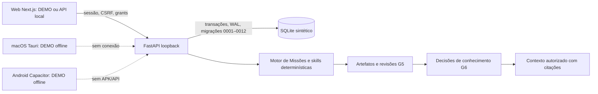

# Arquitetura e mapa dos módulos

**Fronteiras:** `/` e áreas DEMO usam `fixtures/demo.json`/estado do navegador; `/real` usa SQLite local vazio por padrão e dados sintéticos de teste. `domain_id` classifica; sessão e grant de recurso/domínio autorizam. Grant não persiste nem atravessa processo. CORS, Host, client e bind exigem loopback. Sem OAuth, dados reais, serviço remoto ou LLM.

**Fluxo implementado:** a UI escolhe um arquivo fictício UTF-8 de até 50 KB, calcula SHA-256 e envia com confirmação e chave idempotente. `selected_source_api.py` valida principal, domínio, sessão e grant de escrita dentro da transação; registra metadados em `selected_synthetic_sources`, artefato pendente e conhecimento `staged`. A revisão de artefato persiste snapshot imutável por versão. `knowledge_api.py` só aprova conhecimento se o artefato de origem estiver aprovado e íntegro; para original selecionado, exige também igualdade exata entre texto do conhecimento e snapshot. `assemble_context` exige leitura autorizada, limita caracteres e fornece IDs/hashes/citações. A skill `build-context` usa o contexto aprovado em uma execução sintética de Missão. Cada decisão é separada.

**Contratos compartilhados existentes:** `contracts/jarvis.missions.v1.schema.json`, validação Python em `apps/api/mission_contracts.py` e tipos TS em `apps/web/lib/mission-contracts.ts`. Ainda falta SDK comum para os três clientes, geração automática de tipos, `OfflineOutbox` transversal e `SyncEnvelope`; nenhuma sincronização entre dispositivos é alegada.

**Módulos:** `apps/api/local_security.py` sessão/grants; `mission_repository.py` persistência/idempotência/revisões; `mission_engine.py` execução sintética; `review_api.py` decisões; `knowledge_api.py` contexto; `selected_source_api.py` escolha explícita. `apps/web/components/missions/MissionApiPanel.tsx` UI sintética. `apps/desktop` e `apps/mobile` são shells DEMO independentes.

**ADR pendente:** serviço remoto exigiria substituir SQLite local/locks e redesenhar identidade, revogação e armazenamento seguro. Nenhuma plataforma de nuvem foi escolhida ou testada nesta operação.
