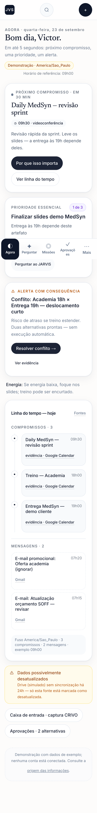
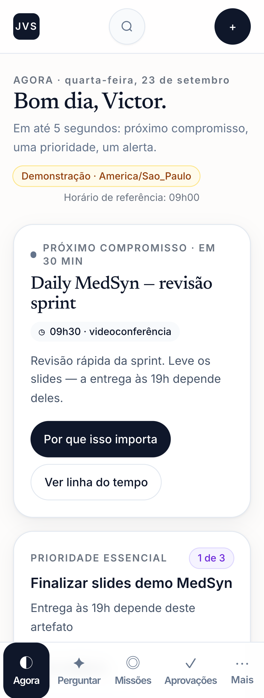
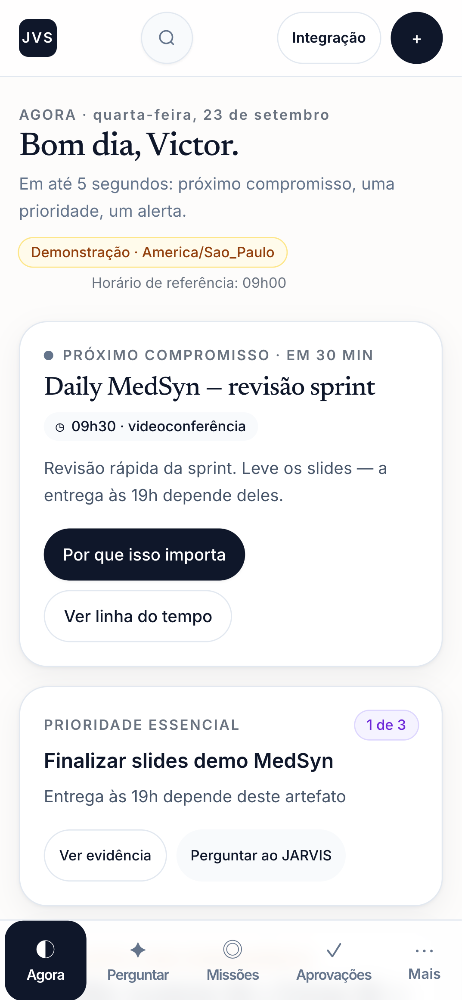
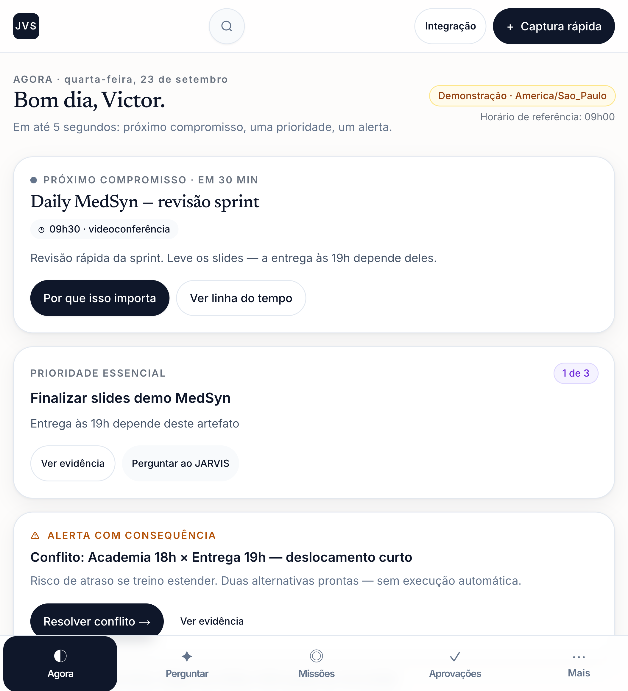
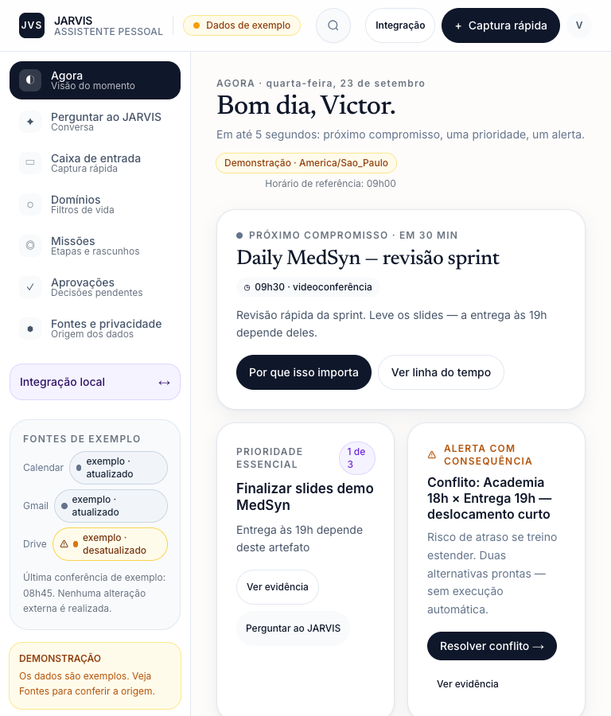
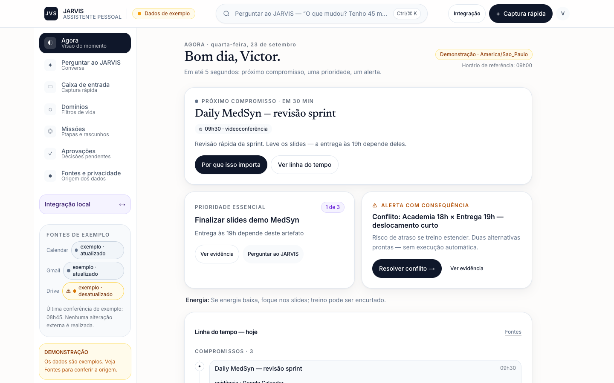

# R5 — capturas comparativas

As imagens vêm da inspeção das telas da aplicação em execução. O teste responsivo valida os dez breakpoints em Chrome desktop e mobile e salva uma captura de viewport em cada largura. As capturas de página inteira das jornadas noturnas também estão nos diretórios de rodada.

## 320 px — rótulo de Aprovações

**R4 congelada:** o rótulo quebra e deixa “es” numa linha isolada. **R5:** o texto fica numa linha dentro do alvo de toque de 44 px ou maior.

| R4 | R5 |
|---|---|
|  |  |

## Amostras da revisão visual

| Viewport | Captura |
|---|---|
| Mobile 390 px |  |
| Mobile 767 px |  |
| Desktop 768 px |  |
| Desktop 1440 px |  |

As capturas completas das duas rodadas estão em `captures/round-1/` e `captures/round-2/`. Cada rodada cobriu 320, 360, 390, 600, 767, 768, 769, 820, 1024 e 1440 px nos projetos desktop e mobile; ambas terminaram com 64 testes aprovados e 2 skips esperados por seleção de projeto. Na inspeção da segunda rodada, o menu móvel permaneceu sem rótulos quebrados e com controles de 44 px ou mais; a navegação desktop apareceu a partir de 768 px.
